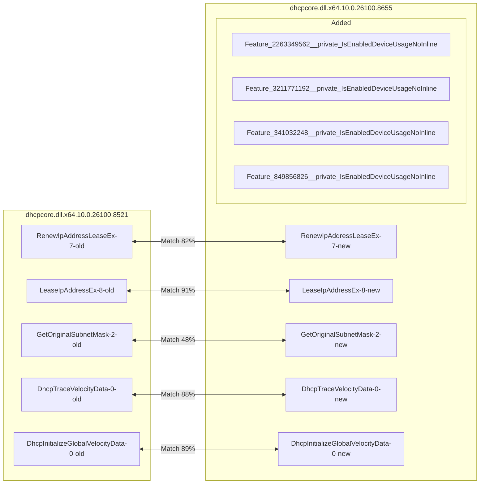
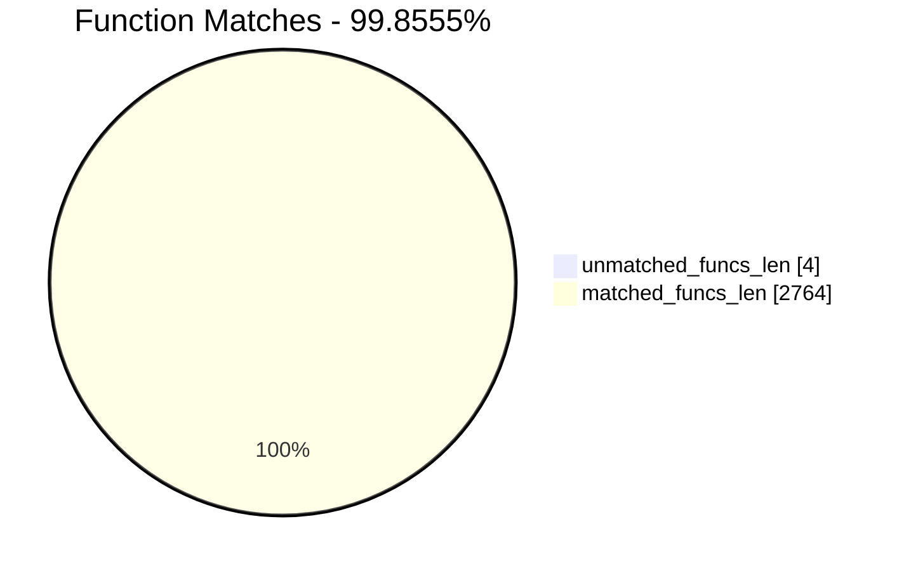
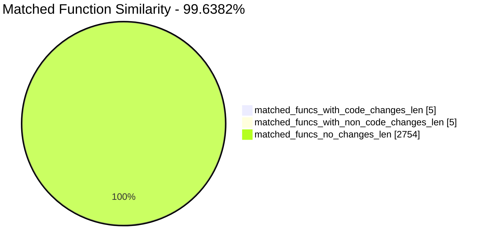
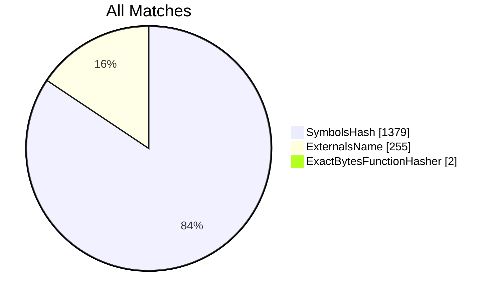
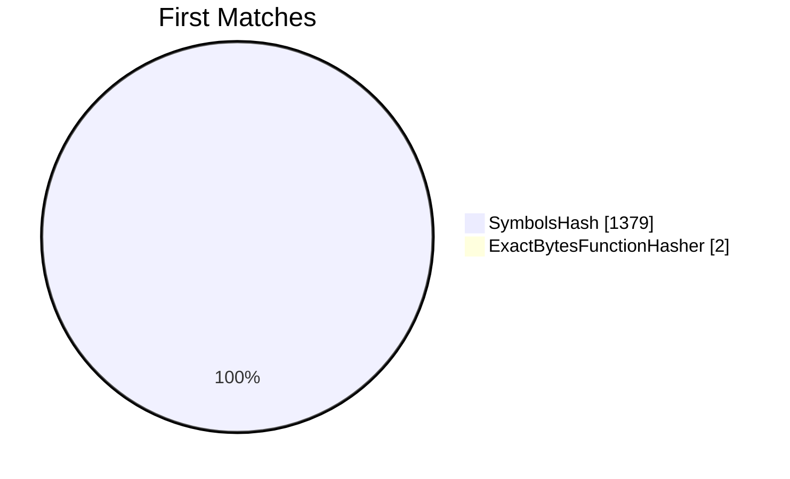
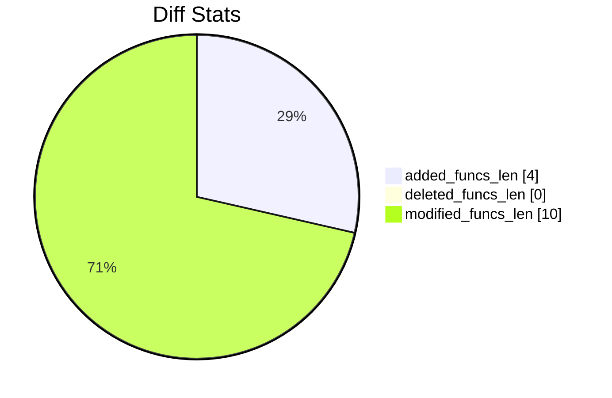
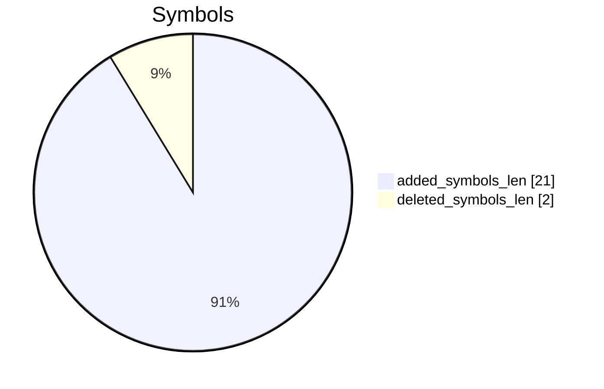

# CVE-2026-44815 Windows DHCP Client

# TOC

* [Visual Chart Diff](#visual-chart-diff)
* [Metadata](#metadata)
	* [Ghidra Diff Engine](#ghidra-diff-engine)
		* [Command Line](#command-line)
	* [Binary Metadata Diff](#binary-metadata-diff)
	* [Program Options](#program-options)
	* [Diff Stats](#diff-stats)
	* [Strings](#strings)
* [Deleted](#deleted)
* [Added](#added)
	* [Feature_2263349562__private_IsEnabledDeviceUsageNoInline](#feature_2263349562__private_isenableddeviceusagenoinline)
	* [Feature_3211771192__private_IsEnabledDeviceUsageNoInline](#feature_3211771192__private_isenableddeviceusagenoinline)
	* [Feature_341032248__private_IsEnabledDeviceUsageNoInline](#feature_341032248__private_isenableddeviceusagenoinline)
	* [Feature_849856826__private_IsEnabledDeviceUsageNoInline](#feature_849856826__private_isenableddeviceusagenoinline)
* [Modified](#modified)
	* [RenewIpAddressLeaseEx](#renewipaddressleaseex)
	* [LeaseIpAddressEx](#leaseipaddressex)
	* [GetOriginalSubnetMask](#getoriginalsubnetmask)
	* [DhcpTraceVelocityData](#dhcptracevelocitydata)
	* [DhcpInitializeGlobalVelocityData](#dhcpinitializeglobalvelocitydata)
* [Modified (No Code Changes)](#modified-no-code-changes)
	* [WS2_32.DLL::Ordinal_14](#ws2_32dllordinal_14)
	* [WPP_SF_L](#wpp_sf_l)
	* [WPP_SF_DJ](#wpp_sf_dj)
	* [wil_details_IsEnabledFallback](#wil_details_isenabledfallback)

# Visual Chart Diff










# Metadata

## Ghidra Diff Engine

### Command Line

#### Captured Command Line


```
ghidriff --project-location /tmp/ws2-dhcp-backup/ghidra-projects --project-name ws2_dhcp_backup --symbols-path /tmp/ws2-dhcp-backup/symbols --gzfs-path gzfs --log-level INFO --file-log-level INFO --log-path ghidriff.log --min-func-len 10 --gdt ['/tmp/ws2-dhcp-backup/windows_vs12_64.gdt'] --bsim --max-ram-percent 60.0 --max-section-funcs 200 --md-title CVE-2026-44815 Windows DHCP Client dhcpcore.dll.x64.10.0.26100.8521 dhcpcore.dll.x64.10.0.26100.8655
```


#### Verbose Args


<details>

```
--old ['/tmp/ws2-dhcp-backup/dhcpcore.dll.x64.10.0.26100.8521'] --new [['/tmp/ws2-dhcp-backup/dhcpcore.dll.x64.10.0.26100.8655']] --engine VersionTrackingDiff --output-path /tmp/ws2-dhcp-backup/ghidriff-output --summary False --project-location /tmp/ws2-dhcp-backup/ghidra-projects --project-name ws2_dhcp_backup --symbols-path /tmp/ws2-dhcp-backup/symbols --gzfs-path gzfs --base-address None --program-options None --threaded False --force-analysis False --force-diff False --no-symbols False --log-level INFO --file-log-level INFO --log-path ghidriff.log --va False --min-func-len 10 --use-calling-counts False --gdt ['/tmp/ws2-dhcp-backup/windows_vs12_64.gdt'] --bsim True --bsim-full False --max-ram-percent 60.0 --print-flags False --jvm-args None --side-by-side False --max-section-funcs 200 --md-title CVE-2026-44815 Windows DHCP Client
```


</details>

#### Download Original PEs


```
wget https://msdl.microsoft.com/download/symbols/dhcpcore.dll/6121CEE175000/dhcpcore.dll -O dhcpcore.dll.x64.10.0.26100.8521
wget https://msdl.microsoft.com/download/symbols/dhcpcore.dll/652F0FA475000/dhcpcore.dll -O dhcpcore.dll.x64.10.0.26100.8655
```


## Binary Metadata Diff


```diff
--- dhcpcore.dll.x64.10.0.26100.8521 Meta
+++ dhcpcore.dll.x64.10.0.26100.8655 Meta
@@ -1,44 +1,44 @@
-Program Name: dhcpcore.dll.x64.10.0.26100.8521
+Program Name: dhcpcore.dll.x64.10.0.26100.8655
 Language ID: x86:LE:64:default (4.7)
 Compiler ID: windows
 Processor: x86
 Endian: Little
 Address Size: 64
 Minimum Address: 180000000
 Maximum Address: ff0000184f
-# of Bytes: 481888
+# of Bytes: 481952
 # of Memory Blocks: 11
-# of Instructions: 76851
-# of Defined Data: 5073
-# of Functions: 1382
-# of Symbols: 14126
+# of Instructions: 76995
+# of Defined Data: 5104
+# of Functions: 1386
+# of Symbols: 14163
 # of Data Types: 549
 # of Data Type Categories: 43
 Analyzed: true
 Compiler: visualstudio:unknown
 Created With Ghidra Version: 12.1.2
 Date Created: Fri Aug 07 15:35:50 UTC 2026
 Executable Format: Portable Executable (PE)
-Executable Location: /tmp/ws2-dhcp-backup/dhcpcore.dll.x64.10.0.26100.8521
-Executable MD5: b30007e4e6b140cb9bb13b26cba312c0
-Executable SHA256: c0fc36971302683b7da6ba62a555a0bb7f1e28db4dfbe45424c11a69fa6abd99
-FSRL: file:///tmp/ws2-dhcp-backup/dhcpcore.dll.x64.10.0.26100.8521?MD5=b30007e4e6b140cb9bb13b26cba312c0
+Executable Location: /tmp/ws2-dhcp-backup/dhcpcore.dll.x64.10.0.26100.8655
+Executable MD5: 0b371e98b37819f9949439f0d4d6d712
+Executable SHA256: d600b0f01f3c9a5877c2171af011f0f63216606acf4ae367827f7f2c3c6655e4
+FSRL: file:///tmp/ws2-dhcp-backup/dhcpcore.dll.x64.10.0.26100.8655?MD5=0b371e98b37819f9949439f0d4d6d712
 PDB Age: 1
 PDB File: dhcpcore.pdb
-PDB GUID: 4aaedddc-450a-1e66-eebb-0a9635c43f2e
+PDB GUID: f930f91f-bbb8-1f1b-a7a6-d1821f8f9ed9
 PDB Loaded: true
 PDB Version: RSDS
 PE Property[CompanyName]: Microsoft Corporation
 PE Property[FileDescription]: DHCP Client Service
-PE Property[FileVersion]: 10.0.26100.8521 (WinBuild.160101.0800)
+PE Property[FileVersion]: 10.0.26100.8655 (WinBuild.160101.0800)
 PE Property[InternalName]: dhcpcore.dll
 PE Property[LegalCopyright]: © Microsoft Corporation. All rights reserved.
 PE Property[OriginalFilename]: dhcpcore.dll
 PE Property[ProductName]: Microsoft® Windows® Operating System
-PE Property[ProductVersion]: 10.0.26100.8521
+PE Property[ProductVersion]: 10.0.26100.8655
 PE Property[Translation]: 4b00409
 Preferred Root Namespace Category: 
 RTTI Found: false
 Relocatable: true
 SectionAlignment: 4096
 Should Ask To Analyze: false

```


## Program Options


<details>
<summary>Ghidra dhcpcore.dll.x64.10.0.26100.8521 Decompiler Options</summary>


|Decompiler Option|Value|
| :---: | :---: |
|Prototype Evaluation|__fastcall|

</details>


<details>
<summary>Ghidra dhcpcore.dll.x64.10.0.26100.8521 Specification extensions Options</summary>


|Specification extensions Option|Value|
| :---: | :---: |
|FormatVersion|0|
|VersionCounter|0|

</details>


<details>
<summary>Ghidra dhcpcore.dll.x64.10.0.26100.8521 Analyzers Options</summary>


|Analyzers Option|Value|
| :---: | :---: |
|ASCII Strings|true|
|ASCII Strings.Create Strings Containing Existing Strings|true|
|ASCII Strings.Create Strings Containing References|true|
|ASCII Strings.Force Model Reload|false|
|ASCII Strings.Minimum String Length|LEN_5|
|ASCII Strings.Model File|StringModel.sng|
|ASCII Strings.Require Null Termination for String|true|
|ASCII Strings.Search Only in Accessible Memory Blocks|true|
|ASCII Strings.String Start Alignment|ALIGN_1|
|ASCII Strings.String end alignment|4|
|Aggressive Instruction Finder|false|
|Aggressive Instruction Finder.Create Analysis Bookmarks|true|
|Apply Data Archives|true|
|Apply Data Archives.Archive Chooser|[Auto-Detect]|
|Apply Data Archives.Create Analysis Bookmarks|true|
|Apply Data Archives.GDT User File Archive Path|None|
|Apply Data Archives.User Project Archive Path|None|
|Call Convention ID|true|
|Call Convention ID.Analysis Decompiler Timeout (sec)|60|
|Call-Fixup Installer|true|
|Condense Filler Bytes|false|
|Condense Filler Bytes.Filler Value|Auto|
|Condense Filler Bytes.Minimum number of sequential bytes|1|
|Create Address Tables|true|
|Create Address Tables.Allow Offcut References|false|
|Create Address Tables.Auto Label Table|false|
|Create Address Tables.Create Analysis Bookmarks|true|
|Create Address Tables.Maxmimum Pointer Distance|16777215|
|Create Address Tables.Minimum Pointer Address|4132|
|Create Address Tables.Minimum Table Size|2|
|Create Address Tables.Pointer Alignment|1|
|Create Address Tables.Relocation Table Guide|true|
|Create Address Tables.Table Alignment|4|
|Data Reference|true|
|Data Reference.Address Table Alignment|1|
|Data Reference.Address Table Minimum Size|2|
|Data Reference.Align End of Strings|false|
|Data Reference.Ascii String References|true|
|Data Reference.Create Address Tables|true|
|Data Reference.Minimum String Length|5|
|Data Reference.References to Pointers|true|
|Data Reference.Relocation Table Guide|true|
|Data Reference.Respect Execute Flag|true|
|Data Reference.Subroutine References|true|
|Data Reference.Switch Table References|false|
|Data Reference.Unicode String References|true|
|Decompiler Parameter ID|true|
|Decompiler Parameter ID.Analysis Clear Level|ANALYSIS|
|Decompiler Parameter ID.Analysis Decompiler Timeout (sec)|60|
|Decompiler Parameter ID.Commit Data Types|true|
|Decompiler Parameter ID.Commit Void Return Values|false|
|Decompiler Parameter ID.Prototype Evaluation|__fastcall|
|Decompiler Switch Analysis|true|
|Decompiler Switch Analysis.Analysis Decompiler Timeout (sec)|60|
|Demangler Microsoft|true|
|Demangler Microsoft.msdApplyOptions|{
	interpretation: FUNCTION_IF_EXISTS,
	applyCallingConvention: true,
	applySignature: true,
	demangleOnlyKnownPatterns: true,
	doDisassembly: true
}|
|Demangler Microsoft.msdOutputOptions|ghidra.app.util.demangler.microsoft.options.MsdOutputOption@9e5b|
|Disassemble Entry Points|true|
|Disassemble Entry Points.Respect Execute Flag|true|
|Embedded Media|true|
|Embedded Media.Create Analysis Bookmarks|true|
|External Entry References|true|
|Function ID|true|
|Function ID.Always Apply FID Labels|false|
|Function ID.Create Analysis Bookmarks|true|
|Function ID.Instruction Count Threshold|14.6|
|Function ID.Multiple Match Threshold|30.0|
|Function Start Search|true|
|Function Start Search.Bookmark Functions|false|
|Function Start Search.Search Data Blocks|false|
|Non-Returning Functions - Discovered|true|
|Non-Returning Functions - Discovered.Create Analysis Bookmarks|true|
|Non-Returning Functions - Discovered.Function Non-return Threshold|3|
|Non-Returning Functions - Discovered.Repair Flow Damage|true|
|Non-Returning Functions - Known|true|
|Non-Returning Functions - Known.Create Analysis Bookmarks|true|
|PDB MSDIA|false|
|PDB MSDIA.Search untrusted symbol servers|false|
|PDB Universal|true|
|PDB Universal.Import Source Line Info|true|
|PDB Universal.Search untrusted symbol servers|false|
|Reference|true|
|Reference.Address Table Alignment|1|
|Reference.Address Table Minimum Size|2|
|Reference.Align End of Strings|false|
|Reference.Ascii String References|true|
|Reference.Create Address Tables|true|
|Reference.Minimum String Length|5|
|Reference.References to Pointers|true|
|Reference.Relocation Table Guide|true|
|Reference.Respect Execute Flag|true|
|Reference.Subroutine References|true|
|Reference.Switch Table References|false|
|Reference.Unicode String References|true|
|Scalar Operand References|true|
|Scalar Operand References.Relocation Table Guide|true|
|Shared Return Calls|true|
|Shared Return Calls.Allow Conditional Jumps|false|
|Shared Return Calls.Assume Contiguous Functions Only|true|
|Stack|true|
|Stack.Create Local Variables|true|
|Stack.Create Param Variables|false|
|Stack.Max Threads|2|
|Subroutine References|true|
|Subroutine References.Create Thunks Early|true|
|Variadic Function Signature Override|false|
|Variadic Function Signature Override.Create Analysis Bookmarks|false|
|Windows x86 PE Exception Handling|true|
|Windows x86 PE RTTI Analyzer|true|
|Windows x86 Thread Environment Block (TEB) Analyzer|true|
|Windows x86 Thread Environment Block (TEB) Analyzer.Starting Address of the TEB||
|Windows x86 Thread Environment Block (TEB) Analyzer.Windows OS Version|Windows 7|
|WindowsPE x86 Propagate External Parameters|false|
|WindowsResourceReference|true|
|WindowsResourceReference.Create Analysis Bookmarks|true|
|x86 Constant Reference Analyzer|true|
|x86 Constant Reference Analyzer.Create Data from pointer|false|
|x86 Constant Reference Analyzer.Function parameter/return Pointer analysis|true|
|x86 Constant Reference Analyzer.Max Threads|2|
|x86 Constant Reference Analyzer.Min absolute reference|4|
|x86 Constant Reference Analyzer.Require pointer param data type|false|
|x86 Constant Reference Analyzer.Speculative reference max|256|
|x86 Constant Reference Analyzer.Speculative reference min|1024|
|x86 Constant Reference Analyzer.Stored Value Pointer analysis|true|
|x86 Constant Reference Analyzer.Trust values read from writable memory|true|

</details>


<details>
<summary>Ghidra dhcpcore.dll.x64.10.0.26100.8655 Decompiler Options</summary>


|Decompiler Option|Value|
| :---: | :---: |
|Prototype Evaluation|__fastcall|

</details>


<details>
<summary>Ghidra dhcpcore.dll.x64.10.0.26100.8655 Specification extensions Options</summary>


|Specification extensions Option|Value|
| :---: | :---: |
|FormatVersion|0|
|VersionCounter|0|

</details>


<details>
<summary>Ghidra dhcpcore.dll.x64.10.0.26100.8655 Analyzers Options</summary>


|Analyzers Option|Value|
| :---: | :---: |
|ASCII Strings|true|
|ASCII Strings.Create Strings Containing Existing Strings|true|
|ASCII Strings.Create Strings Containing References|true|
|ASCII Strings.Force Model Reload|false|
|ASCII Strings.Minimum String Length|LEN_5|
|ASCII Strings.Model File|StringModel.sng|
|ASCII Strings.Require Null Termination for String|true|
|ASCII Strings.Search Only in Accessible Memory Blocks|true|
|ASCII Strings.String Start Alignment|ALIGN_1|
|ASCII Strings.String end alignment|4|
|Aggressive Instruction Finder|false|
|Aggressive Instruction Finder.Create Analysis Bookmarks|true|
|Apply Data Archives|true|
|Apply Data Archives.Archive Chooser|[Auto-Detect]|
|Apply Data Archives.Create Analysis Bookmarks|true|
|Apply Data Archives.GDT User File Archive Path|None|
|Apply Data Archives.User Project Archive Path|None|
|Call Convention ID|true|
|Call Convention ID.Analysis Decompiler Timeout (sec)|60|
|Call-Fixup Installer|true|
|Condense Filler Bytes|false|
|Condense Filler Bytes.Filler Value|Auto|
|Condense Filler Bytes.Minimum number of sequential bytes|1|
|Create Address Tables|true|
|Create Address Tables.Allow Offcut References|false|
|Create Address Tables.Auto Label Table|false|
|Create Address Tables.Create Analysis Bookmarks|true|
|Create Address Tables.Maxmimum Pointer Distance|16777215|
|Create Address Tables.Minimum Pointer Address|4132|
|Create Address Tables.Minimum Table Size|2|
|Create Address Tables.Pointer Alignment|1|
|Create Address Tables.Relocation Table Guide|true|
|Create Address Tables.Table Alignment|4|
|Data Reference|true|
|Data Reference.Address Table Alignment|1|
|Data Reference.Address Table Minimum Size|2|
|Data Reference.Align End of Strings|false|
|Data Reference.Ascii String References|true|
|Data Reference.Create Address Tables|true|
|Data Reference.Minimum String Length|5|
|Data Reference.References to Pointers|true|
|Data Reference.Relocation Table Guide|true|
|Data Reference.Respect Execute Flag|true|
|Data Reference.Subroutine References|true|
|Data Reference.Switch Table References|false|
|Data Reference.Unicode String References|true|
|Decompiler Parameter ID|true|
|Decompiler Parameter ID.Analysis Clear Level|ANALYSIS|
|Decompiler Parameter ID.Analysis Decompiler Timeout (sec)|60|
|Decompiler Parameter ID.Commit Data Types|true|
|Decompiler Parameter ID.Commit Void Return Values|false|
|Decompiler Parameter ID.Prototype Evaluation|__fastcall|
|Decompiler Switch Analysis|true|
|Decompiler Switch Analysis.Analysis Decompiler Timeout (sec)|60|
|Demangler Microsoft|true|
|Demangler Microsoft.msdApplyOptions|{
	interpretation: FUNCTION_IF_EXISTS,
	applyCallingConvention: true,
	applySignature: true,
	demangleOnlyKnownPatterns: true,
	doDisassembly: true
}|
|Demangler Microsoft.msdOutputOptions|ghidra.app.util.demangler.microsoft.options.MsdOutputOption@9e5b|
|Disassemble Entry Points|true|
|Disassemble Entry Points.Respect Execute Flag|true|
|Embedded Media|true|
|Embedded Media.Create Analysis Bookmarks|true|
|External Entry References|true|
|Function ID|true|
|Function ID.Always Apply FID Labels|false|
|Function ID.Create Analysis Bookmarks|true|
|Function ID.Instruction Count Threshold|14.6|
|Function ID.Multiple Match Threshold|30.0|
|Function Start Search|true|
|Function Start Search.Bookmark Functions|false|
|Function Start Search.Search Data Blocks|false|
|Non-Returning Functions - Discovered|true|
|Non-Returning Functions - Discovered.Create Analysis Bookmarks|true|
|Non-Returning Functions - Discovered.Function Non-return Threshold|3|
|Non-Returning Functions - Discovered.Repair Flow Damage|true|
|Non-Returning Functions - Known|true|
|Non-Returning Functions - Known.Create Analysis Bookmarks|true|
|PDB MSDIA|false|
|PDB MSDIA.Search untrusted symbol servers|false|
|PDB Universal|true|
|PDB Universal.Import Source Line Info|true|
|PDB Universal.Search untrusted symbol servers|false|
|Reference|true|
|Reference.Address Table Alignment|1|
|Reference.Address Table Minimum Size|2|
|Reference.Align End of Strings|false|
|Reference.Ascii String References|true|
|Reference.Create Address Tables|true|
|Reference.Minimum String Length|5|
|Reference.References to Pointers|true|
|Reference.Relocation Table Guide|true|
|Reference.Respect Execute Flag|true|
|Reference.Subroutine References|true|
|Reference.Switch Table References|false|
|Reference.Unicode String References|true|
|Scalar Operand References|true|
|Scalar Operand References.Relocation Table Guide|true|
|Shared Return Calls|true|
|Shared Return Calls.Allow Conditional Jumps|false|
|Shared Return Calls.Assume Contiguous Functions Only|true|
|Stack|true|
|Stack.Create Local Variables|true|
|Stack.Create Param Variables|false|
|Stack.Max Threads|2|
|Subroutine References|true|
|Subroutine References.Create Thunks Early|true|
|Variadic Function Signature Override|false|
|Variadic Function Signature Override.Create Analysis Bookmarks|false|
|Windows x86 PE Exception Handling|true|
|Windows x86 PE RTTI Analyzer|true|
|Windows x86 Thread Environment Block (TEB) Analyzer|true|
|Windows x86 Thread Environment Block (TEB) Analyzer.Starting Address of the TEB||
|Windows x86 Thread Environment Block (TEB) Analyzer.Windows OS Version|Windows 7|
|WindowsPE x86 Propagate External Parameters|false|
|WindowsResourceReference|true|
|WindowsResourceReference.Create Analysis Bookmarks|true|
|x86 Constant Reference Analyzer|true|
|x86 Constant Reference Analyzer.Create Data from pointer|false|
|x86 Constant Reference Analyzer.Function parameter/return Pointer analysis|true|
|x86 Constant Reference Analyzer.Max Threads|2|
|x86 Constant Reference Analyzer.Min absolute reference|4|
|x86 Constant Reference Analyzer.Require pointer param data type|false|
|x86 Constant Reference Analyzer.Speculative reference max|256|
|x86 Constant Reference Analyzer.Speculative reference min|1024|
|x86 Constant Reference Analyzer.Stored Value Pointer analysis|true|
|x86 Constant Reference Analyzer.Trust values read from writable memory|true|

</details>

## Diff Stats


|Stat|Value|
| :---: | :---: |
|added_funcs_len|4|
|deleted_funcs_len|0|
|modified_funcs_len|10|
|added_symbols_len|21|
|deleted_symbols_len|2|
|diff_time|3.8734896183013916|
|deleted_strings_len|0|
|added_strings_len|0|
|match_types|Counter({'SymbolsHash': 1379, 'ExternalsName': 255, 'ExactBytesFunctionHasher': 2})|
|items_to_process|37|
|diff_types|Counter({'address': 7, 'refcount': 5, 'code': 5, 'length': 5, 'sig': 2, 'calling': 1, 'called': 1})|
|unmatched_funcs_len|4|
|total_funcs_len|2768|
|matched_funcs_len|2764|
|matched_funcs_with_code_changes_len|5|
|matched_funcs_with_non_code_changes_len|5|
|matched_funcs_no_changes_len|2754|
|match_func_similarity_percent|99.6382%|
|func_match_overall_percent|99.8555%|
|first_matches|Counter({'SymbolsHash': 1379, 'ExactBytesFunctionHasher': 2})|













## Strings


*No string differences found*

# Deleted

# Added

## Feature_2263349562__private_IsEnabledDeviceUsageNoInline

### Function Meta


|Key|dhcpcore.dll.x64.10.0.26100.8655|
| :---: | :---: |
|name|Feature_2263349562__private_IsEnabledDeviceUsageNoInline|
|fullname|Feature_2263349562__private_IsEnabledDeviceUsageNoInline|
|refcount|1|
|length|51|
|called|wil_details_IsEnabledFallback|
|calling|DhcpInitializeGlobalVelocityData|
|paramcount|0|
|address|180047f38|
|sig|uint __fastcall Feature_2263349562__private_IsEnabledDeviceUsageNoInline(void)|
|sym_type|Function|
|sym_source|IMPORTED|
|external|False|


```diff
--- Feature_2263349562__private_IsEnabledDeviceUsageNoInline
+++ Feature_2263349562__private_IsEnabledDeviceUsageNoInline
@@ -0,0 +1,15 @@
+
+uint Feature_2263349562__private_IsEnabledDeviceUsageNoInline(void)
+
+{
+  uint uVar1;
+  ulonglong local_res8;
+  
+  local_res8 = (ulonglong)Feature_2263349562__private_featureState;
+  if ((Feature_2263349562__private_featureState & 0x10) != 0) {
+    return Feature_2263349562__private_featureState & 1;
+  }
+  uVar1 = wil_details_IsEnabledFallback(local_res8,3,&Feature_2263349562__private_descriptor);
+  return uVar1;
+}
+

```


## Feature_3211771192__private_IsEnabledDeviceUsageNoInline

### Function Meta


|Key|dhcpcore.dll.x64.10.0.26100.8655|
| :---: | :---: |
|name|Feature_3211771192__private_IsEnabledDeviceUsageNoInline|
|fullname|Feature_3211771192__private_IsEnabledDeviceUsageNoInline|
|refcount|1|
|length|51|
|called|wil_details_IsEnabledFallback|
|calling|DhcpInitializeGlobalVelocityData|
|paramcount|0|
|address|180047f7c|
|sig|uint __fastcall Feature_3211771192__private_IsEnabledDeviceUsageNoInline(void)|
|sym_type|Function|
|sym_source|IMPORTED|
|external|False|


```diff
--- Feature_3211771192__private_IsEnabledDeviceUsageNoInline
+++ Feature_3211771192__private_IsEnabledDeviceUsageNoInline
@@ -0,0 +1,15 @@
+
+uint Feature_3211771192__private_IsEnabledDeviceUsageNoInline(void)
+
+{
+  uint uVar1;
+  ulonglong local_res8;
+  
+  local_res8 = (ulonglong)Feature_3211771192__private_featureState;
+  if ((Feature_3211771192__private_featureState & 0x10) != 0) {
+    return Feature_3211771192__private_featureState & 1;
+  }
+  uVar1 = wil_details_IsEnabledFallback(local_res8,3,&Feature_3211771192__private_descriptor);
+  return uVar1;
+}
+

```


## Feature_341032248__private_IsEnabledDeviceUsageNoInline

### Function Meta


|Key|dhcpcore.dll.x64.10.0.26100.8655|
| :---: | :---: |
|name|Feature_341032248__private_IsEnabledDeviceUsageNoInline|
|fullname|Feature_341032248__private_IsEnabledDeviceUsageNoInline|
|refcount|1|
|length|51|
|called|wil_details_IsEnabledFallback|
|calling|DhcpInitializeGlobalVelocityData|
|paramcount|0|
|address|180047fc0|
|sig|uint __fastcall Feature_341032248__private_IsEnabledDeviceUsageNoInline(void)|
|sym_type|Function|
|sym_source|IMPORTED|
|external|False|


```diff
--- Feature_341032248__private_IsEnabledDeviceUsageNoInline
+++ Feature_341032248__private_IsEnabledDeviceUsageNoInline
@@ -0,0 +1,15 @@
+
+uint Feature_341032248__private_IsEnabledDeviceUsageNoInline(void)
+
+{
+  uint uVar1;
+  ulonglong local_res8;
+  
+  local_res8 = (ulonglong)Feature_341032248__private_featureState;
+  if ((Feature_341032248__private_featureState & 0x10) != 0) {
+    return Feature_341032248__private_featureState & 1;
+  }
+  uVar1 = wil_details_IsEnabledFallback(local_res8,3,&Feature_341032248__private_descriptor);
+  return uVar1;
+}
+

```


## Feature_849856826__private_IsEnabledDeviceUsageNoInline

### Function Meta


|Key|dhcpcore.dll.x64.10.0.26100.8655|
| :---: | :---: |
|name|Feature_849856826__private_IsEnabledDeviceUsageNoInline|
|fullname|Feature_849856826__private_IsEnabledDeviceUsageNoInline|
|refcount|1|
|length|51|
|called|wil_details_IsEnabledFallback|
|calling|DhcpInitializeGlobalVelocityData|
|paramcount|0|
|address|18004819c|
|sig|uint __fastcall Feature_849856826__private_IsEnabledDeviceUsageNoInline(void)|
|sym_type|Function|
|sym_source|IMPORTED|
|external|False|


```diff
--- Feature_849856826__private_IsEnabledDeviceUsageNoInline
+++ Feature_849856826__private_IsEnabledDeviceUsageNoInline
@@ -0,0 +1,15 @@
+
+uint Feature_849856826__private_IsEnabledDeviceUsageNoInline(void)
+
+{
+  uint uVar1;
+  ulonglong local_res8;
+  
+  local_res8 = (ulonglong)Feature_849856826__private_featureState;
+  if ((Feature_849856826__private_featureState & 0x10) != 0) {
+    return Feature_849856826__private_featureState & 1;
+  }
+  uVar1 = wil_details_IsEnabledFallback(local_res8,3,&Feature_849856826__private_descriptor);
+  return uVar1;
+}
+

```


# Modified


*Modified functions contain code changes*
## RenewIpAddressLeaseEx

### Match Info


|Key|dhcpcore.dll.x64.10.0.26100.8521 - dhcpcore.dll.x64.10.0.26100.8655|
| :---: | :---: |
|diff_type|code,length,sig,address|
|ratio|0.95|
|i_ratio|0.84|
|m_ratio|1.0|
|b_ratio|0.82|
|match_types|SymbolsHash|

### Function Meta Diff


|Key|dhcpcore.dll.x64.10.0.26100.8521|dhcpcore.dll.x64.10.0.26100.8655|
| :---: | :---: | :---: |
|name|RenewIpAddressLeaseEx|RenewIpAddressLeaseEx|
|fullname|RenewIpAddressLeaseEx|RenewIpAddressLeaseEx|
|refcount|3|3|
|`length`|3143|3179|
|called|<details><summary>Expand for full list:<br>API-MS-WIN-CORE-SYSINFO-L1-1-0.DLL::GetTickCount64<br>API-MS-WIN-CRT-TIME-L1-1-0.DLL::_time64<br>CreateDhcpContext<br>CreateDhcpContextForNewLease<br>DhcpCleanParsedOptions<br>DhcpCommonInit<br>DhcpDestroyContextEx<br>DhcpMakeClientId<br>GetHardwareAddressForIpAddress<br>GetSeed<br>InitializeDhcpSocket</summary>RenewLease<br>WPP_SF_<br>WPP_SF_D<br>WPP_SF_L<br>WS2_32.DLL::Ordinal_11<br>WS2_32.DLL::Ordinal_14<br>WS2_32.DLL::Ordinal_8<br>__security_check_cookie<br>memcpy<br>memset</details>|<details><summary>Expand for full list:<br>API-MS-WIN-CORE-SYSINFO-L1-1-0.DLL::GetTickCount64<br>API-MS-WIN-CRT-TIME-L1-1-0.DLL::_time64<br>CreateDhcpContext<br>CreateDhcpContextForNewLease<br>DhcpCleanParsedOptions<br>DhcpCommonInit<br>DhcpDestroyContextEx<br>DhcpMakeClientId<br>GetHardwareAddressForIpAddress<br>GetSeed<br>InitializeDhcpSocket</summary>RenewLease<br>WPP_SF_<br>WPP_SF_D<br>WPP_SF_L<br>WS2_32.DLL::Ordinal_11<br>WS2_32.DLL::Ordinal_14<br>WS2_32.DLL::Ordinal_8<br>__security_check_cookie<br>memcpy<br>memset</details>|
|calling|RpcSrvRenewIpAddressLeaseEx<br>RpcSrvRenewIpAddressLeaseEx_New|RpcSrvRenewIpAddressLeaseEx<br>RpcSrvRenewIpAddressLeaseEx_New|
|paramcount|7|7|
|`address`|1800404dc|1800405c8|
|`sig`|ulonglong __fastcall RenewIpAddressLeaseEx(uint param_1, longlong param_2, uint * param_3, undefined8 param_4, undefined8 * param_5, undefined8 * param_6, int param_7)|ulonglong __fastcall RenewIpAddressLeaseEx(uint param_1, longlong param_2, uint * param_3, undefined8 param_4, undefined8 * param_5, undefined8 * param_6, uint param_7)|
|sym_type|Function|Function|
|sym_source|IMPORTED|IMPORTED|
|external|False|False|

### RenewIpAddressLeaseEx Diff


```diff
--- RenewIpAddressLeaseEx
+++ RenewIpAddressLeaseEx
@@ -1,611 +1,621 @@
 
 /* WARNING: Function: __security_check_cookie replaced with injection: security_check_cookie */
 
 ulonglong RenewIpAddressLeaseEx
                     (uint param_1,longlong param_2,uint *param_3,undefined8 param_4,
-                    undefined8 *param_5,undefined8 *param_6,int param_7)
+                    undefined8 *param_5,undefined8 *param_6,uint param_7)
 
 {
   int iVar1;
   code *pcVar2;
   undefined1 auVar3 [16];
   undefined1 auVar4 [16];
   undefined1 auVar5 [16];
   undefined1 auVar6 [16];
   undefined1 auVar7 [16];
   undefined1 auVar8 [16];
   undefined1 auVar9 [16];
   undefined1 auVar10 [16];
   undefined1 auVar11 [16];
   undefined1 auVar12 [16];
   undefined1 auVar13 [16];
   undefined1 auVar14 [16];
   undefined1 auVar15 [16];
   undefined8 uVar16;
   undefined8 uVar17;
   undefined8 uVar18;
   undefined8 uVar19;
   undefined4 uVar20;
   uint uVar21;
   uint uVar22;
   DWORD DVar23;
   ulonglong uVar24;
   __time64_t _Var25;
   longlong ******pppppplVar26;
   longlong *******ppppppplVar27;
   ULONGLONG UVar28;
   undefined8 *puVar29;
   undefined8 *puVar30;
   uint *puVar31;
   uint *puVar32;
   longlong ******pppppplVar33;
   ushort uVar34;
   longlong lVar35;
   size_t _Size;
   ulonglong uVar36;
   int iVar37;
   longlong *******ppppppplVar38;
   int iVar39;
   undefined1 auStackY_4d8 [32];
   uint local_494;
   longlong *******local_490;
   uint local_488;
   undefined4 local_484;
   DWORD local_480 [2];
   longlong *******local_478;
   longlong *******ppppppplStack_470;
   undefined8 local_468;
   undefined8 local_460;
   undefined8 local_458;
   undefined8 local_450;
   undefined4 *local_448;
   undefined4 local_440;
   undefined8 local_43c;
   undefined4 local_434;
   undefined8 *local_428;
   undefined1 local_418 [24];
   uint local_400;
   uint local_3fc;
   uint local_3f8;
   undefined8 local_348 [34];
   uint local_238 [68];
   undefined4 local_128;
   undefined2 local_124;
   undefined1 local_122;
   undefined1 local_118 [208];
   ulonglong local_48;
   
   local_48 = __security_cookie ^ (ulonglong)auStackY_4d8;
   local_428 = param_5;
   local_490 = (longlong *******)0x0;
   local_480[0] = 0;
   local_488 = param_1;
   memset(local_418,0,200);
   local_448 = &local_128;
   local_128 = 0x10f2c2e;
   local_124 = 0x603;
   local_43c = 0;
   local_434 = 0;
   local_122 = 0x2f;
   local_484 = 0;
   local_478 = (longlong *******)0x0;
   ppppppplStack_470 = (longlong *******)0x0;
   local_468 = 0x37;
   local_460 = 0;
   local_458 = 0;
   local_450 = 0;
   local_440 = 7;
   if ((DAT_0 & 0x10) != 0) {
-    WPP_SF_D(0x404,0x1c,0x18005ade8,param_1);
+    WPP_SF_D(0x404,0x1d,0x18005ade8,param_1);
+  }
+  if ((g_fVelocityDhcpv4ClassIdLenOverflowFix != 0) && (0xff < param_7)) {
+    if ((DAT_0 & 0x10) == 0) {
+      return 0x57;
+    }
+    uVar34 = 0x1e;
+LAB_1:
+    WPP_SF_(0x404,uVar34,0x18005ade8);
+    return 0x57;
   }
   if (param_2 == 0) {
-    if ((DAT_0 & 0x10) != 0) {
-      WPP_SF_(0x404,0x1d,0x18005ade8);
-    }
-    return 0x57;
+    if ((DAT_0 & 0x10) == 0) {
+      return 0x57;
+    }
+    uVar34 = 0x1f;
+    goto LAB_1;
   }
   uVar24 = DhcpCommonInit();
   uVar36 = uVar24 & 0xffffffff;
   if ((int)uVar24 != 0) {
     if ((DAT_0 & 0x10) == 0) {
       return uVar36;
     }
-    uVar34 = 0x1e;
-    goto LAB_1;
+    uVar34 = 0x20;
+    goto LAB_2;
   }
   if ((param_1 == 0) || (param_1 == 0x7f000001)) {
-LAB_2:
+LAB_3:
     local_494 = *param_3;
     _Size = (size_t)local_494;
     if (200 < local_494) {
       if ((DAT_0 & 0x10) != 0) {
-        WPP_SF_L(0x404,0x1f,0x18005ade8,local_494);
+        WPP_SF_L(0x404,0x21,0x18005ade8,local_494);
       }
       return 0xd;
     }
     memcpy(local_118,(void *)((longlong)param_3 + 5),_Size);
   }
   else {
     local_494 = 200;
     GetHardwareAddressForIpAddress((ulonglong)param_1,local_118,&local_494);
     _Size = (size_t)local_494;
-    if (local_494 == 0) goto LAB_2;
+    if (local_494 == 0) goto LAB_3;
   }
   uVar21 = (uint)_Size;
   if (g_fUseIpv6OnlyPreferred == 0) {
     uVar22 = CreateDhcpContext(&local_490,uVar21);
     ppppppplVar38 = local_490;
     if (uVar22 != 0) {
       if ((DAT_0 & 0x10) != 0) {
-        WPP_SF_D(0x404,0x21,0x18005ade8,uVar22);
+        WPP_SF_D(0x404,0x23,0x18005ade8,uVar22);
       }
       return (ulonglong)uVar22;
     }
     *(undefined1 *)((longlong)local_490 + 0x54) = 1;
     *(uint *)(local_490 + 0xc) = uVar21;
     memcpy(local_490[0xb],local_118,_Size);
     *(undefined4 *)(ppppppplVar38 + 2) = 1;
     *(undefined4 *)(ppppppplVar38 + 0x69) = 0;
     uVar20 = Ordinal_8(*(undefined4 *)(param_2 + 0x10));
     *(undefined4 *)(ppppppplVar38 + 0xf) = uVar20;
     uVar20 = Ordinal_8(*(undefined4 *)(param_2 + 0x14));
     *(undefined4 *)((longlong)ppppppplVar38 + 0x7c) = uVar20;
     _Var25 = _time64((__time64_t *)0x0);
     if (*(uint *)(param_2 + 0x28) < (uint)_Var25) {
       if ((DAT_0 & 0x10) != 0) {
-        WPP_SF_(0x404,0x22,0x18005ade8);
+        WPP_SF_(0x404,0x24,0x18005ade8);
       }
       *(undefined4 *)(ppppppplVar38 + 0x10) = 0xffffffff;
     }
     else {
       uVar20 = Ordinal_8(*(undefined4 *)(param_2 + 0x18));
       *(undefined4 *)(ppppppplVar38 + 0x10) = uVar20;
     }
     *(undefined4 *)((longlong)ppppppplVar38 + 0x84) = *(undefined4 *)(ppppppplVar38 + 0xf);
     *(undefined4 *)(ppppppplVar38 + 0x37) = *(undefined4 *)(param_2 + 0x1c);
     uVar21 = *(uint *)(param_2 + 0x20);
     if (uVar21 == 0xffffffff) {
       pppppplVar33 = (longlong ******)0xffffffff;
     }
     else {
       _Var25 = _time64((__time64_t *)0x0);
       UVar28 = GetTickCount64();
       auVar7._8_8_ = 0;
       auVar7._0_8_ = UVar28;
       lVar35 = SUB168(ZEXT816(0x624dd2f1a9fbe77) * auVar7,8);
       pppppplVar26 = (longlong ******)
                      (((lVar35 + (UVar28 - lVar35 >> 1) >> 9) - _Var25) + (ulonglong)uVar21);
       pppppplVar33 = (longlong ******)0x0;
       if (-1 < (longlong)pppppplVar26) {
         pppppplVar33 = pppppplVar26;
       }
     }
     ppppppplVar38[0x38] = pppppplVar33;
     uVar21 = *(uint *)(param_2 + 0x24);
     if (uVar21 == 0xffffffff) {
       pppppplVar33 = (longlong ******)0xffffffff;
     }
     else {
       _Var25 = _time64((__time64_t *)0x0);
       UVar28 = GetTickCount64();
       auVar8._8_8_ = 0;
       auVar8._0_8_ = UVar28;
       lVar35 = SUB168(ZEXT816(0x624dd2f1a9fbe77) * auVar8,8);
       pppppplVar26 = (longlong ******)
                      (((lVar35 + (UVar28 - lVar35 >> 1) >> 9) - _Var25) + (ulonglong)uVar21);
       pppppplVar33 = (longlong ******)0x0;
       if (-1 < (longlong)pppppplVar26) {
         pppppplVar33 = pppppplVar26;
       }
     }
     ppppppplVar38[0x39] = pppppplVar33;
     uVar21 = *(uint *)(param_2 + 0x28);
     if (uVar21 == 0xffffffff) {
       pppppplVar33 = (longlong ******)0xffffffff;
     }
     else {
       _Var25 = _time64((__time64_t *)0x0);
       UVar28 = GetTickCount64();
       auVar9._8_8_ = 0;
       auVar9._0_8_ = UVar28;
       lVar35 = SUB168(ZEXT816(0x624dd2f1a9fbe77) * auVar9,8);
       pppppplVar26 = (longlong ******)
                      (((lVar35 + (UVar28 - lVar35 >> 1) >> 9) - _Var25) + (ulonglong)uVar21);
       pppppplVar33 = (longlong ******)0x0;
       if (-1 < (longlong)pppppplVar26) {
         pppppplVar33 = pppppplVar26;
       }
     }
     ppppppplVar38[0x3a] = pppppplVar33;
     uVar21 = *(uint *)(param_2 + 0x2c);
     if (uVar21 == 0xffffffff) {
       pppppplVar33 = (longlong ******)0xffffffff;
     }
     else {
       _Var25 = _time64((__time64_t *)0x0);
       UVar28 = GetTickCount64();
       auVar10._8_8_ = 0;
       auVar10._0_8_ = UVar28;
       lVar35 = SUB168(ZEXT816(0x624dd2f1a9fbe77) * auVar10,8);
       pppppplVar26 = (longlong ******)
                      (((lVar35 + (UVar28 - lVar35 >> 1) >> 9) - _Var25) + (ulonglong)uVar21);
       pppppplVar33 = (longlong ******)0x0;
       if (-1 < (longlong)pppppplVar26) {
         pppppplVar33 = pppppplVar26;
       }
     }
     ppppppplVar38[0x3b] = pppppplVar33;
     *(undefined4 *)((longlong)ppppppplVar38 + 0x34c) = 1;
     *(undefined4 *)(ppppppplVar38 + 0x6a) = 1;
     *(undefined4 *)(ppppppplVar38 + 0x61) = 0;
     *(undefined4 *)(ppppppplVar38 + 0x62) = 0;
     *(undefined4 *)((longlong)ppppppplVar38 + 0x314) = 0;
     *(undefined4 *)(ppppppplVar38 + 99) = 1;
     *(undefined4 *)((longlong)ppppppplVar38 + 0x31c) = 0;
     *(undefined4 *)(ppppppplVar38 + 100) = 0;
     *(undefined4 *)(ppppppplVar38 + 0x62) = 1;
     *(undefined4 *)((longlong)ppppppplVar38 + 0x314) = 1;
     *(undefined4 *)(ppppppplVar38 + 0x66) = 1;
     *(undefined4 *)((longlong)ppppppplVar38 + 0x234) = 1;
     *(undefined4 *)(ppppppplVar38 + 0x34) = 0;
     uVar20 = Ordinal_11("169.254.0.0");
     *(undefined4 *)((longlong)ppppppplVar38 + 0x1a4) = uVar20;
     uVar20 = Ordinal_11("255.255.0.0");
     *(undefined4 *)(ppppppplVar38 + 0x35) = uVar20;
     DVar23 = GetSeed();
     *(DWORD *)((longlong)ppppppplVar38 + 0x1ac) = DVar23;
     ppppppplVar27 = ppppppplVar38 + 0x57;
     ppppppplVar38[0x58] = (longlong ******)ppppppplVar27;
     *ppppppplVar27 = (longlong ******)ppppppplVar27;
     local_478 = ppppppplVar38 + 0x55;
     ppppppplVar38[0x56] = (longlong ******)&local_478;
     *local_478 = (longlong ******)&local_478;
     ppppppplVar27 = ppppppplVar38 + 0x59;
     ppppppplVar38[0x5a] = (longlong ******)ppppppplVar27;
     *ppppppplVar27 = (longlong ******)ppppppplVar27;
     if (param_7 == 0) {
       ppppppplVar38[0x5c] = (longlong ******)0x0;
     }
     else {
       ppppppplVar38[0x5c] = (longlong ******)((longlong)param_6 + 4);
     }
     uVar21 = *param_3;
-    *(int *)(ppppppplVar38 + 0x5d) = param_7;
+    *(uint *)(ppppppplVar38 + 0x5d) = param_7;
     ppppppplStack_470 = local_478;
     uVar21 = DhcpMakeClientId(1,uVar21,(void *)((longlong)param_3 + 5),ppppppplVar38 + 0x36);
     uVar36 = (ulonglong)uVar21;
     if (uVar21 == 0) {
       ppppppplVar38[7] = (longlong ******)0x0;
       ppppppplVar38[9] = (longlong ******)0xffffffffffffffff;
       ppppppplVar38[8] = (longlong ******)0xffffffffffffffff;
-      goto LAB_3;
-    }
-LAB_4:
+      goto LAB_4;
+    }
+LAB_5:
     if ((DAT_0 & 2) != 0) {
-      WPP_SF_D(0x401,0x25,0x18005ade8,(int)uVar36);
+      WPP_SF_D(0x401,0x27,0x18005ade8,(int)uVar36);
     }
   }
   else {
     uVar20 = Ordinal_8(*(undefined4 *)(param_2 + 0x10));
     lVar35 = 2;
     puVar29 = local_348;
     do {
       uVar16 = param_6[1];
       uVar17 = param_6[2];
       uVar18 = param_6[3];
       *puVar29 = *param_6;
       puVar29[1] = uVar16;
       uVar16 = param_6[4];
       uVar19 = param_6[5];
       puVar29[2] = uVar17;
       puVar29[3] = uVar18;
       uVar17 = param_6[6];
       uVar18 = param_6[7];
       puVar29[4] = uVar16;
       puVar29[5] = uVar19;
       uVar16 = param_6[8];
       uVar19 = param_6[9];
       puVar29[6] = uVar17;
       puVar29[7] = uVar18;
       uVar17 = param_6[10];
       uVar18 = param_6[0xb];
       puVar29[8] = uVar16;
       puVar29[9] = uVar19;
       uVar16 = param_6[0xc];
       uVar19 = param_6[0xd];
       puVar29[10] = uVar17;
       puVar29[0xb] = uVar18;
       uVar17 = param_6[0xe];
       uVar18 = param_6[0xf];
       param_6 = param_6 + 0x10;
       puVar29[0xc] = uVar16;
       puVar29[0xd] = uVar19;
       puVar30 = puVar29 + 0x10;
       puVar29[0xe] = uVar17;
       puVar29[0xf] = uVar18;
       lVar35 = lVar35 + -1;
       puVar29 = puVar30;
     } while (lVar35 != 0);
     *(undefined4 *)puVar30 = *(undefined4 *)param_6;
     lVar35 = 2;
     puVar31 = local_238;
     do {
       uVar16 = *(undefined8 *)(param_3 + 2);
       uVar17 = *(undefined8 *)(param_3 + 4);
       uVar18 = *(undefined8 *)(param_3 + 6);
       *(undefined8 *)puVar31 = *(undefined8 *)param_3;
       *(undefined8 *)(puVar31 + 2) = uVar16;
       uVar16 = *(undefined8 *)(param_3 + 8);
       uVar19 = *(undefined8 *)(param_3 + 10);
       *(undefined8 *)(puVar31 + 4) = uVar17;
       *(undefined8 *)(puVar31 + 6) = uVar18;
       uVar17 = *(undefined8 *)(param_3 + 0xc);
       uVar18 = *(undefined8 *)(param_3 + 0xe);
       *(undefined8 *)(puVar31 + 8) = uVar16;
       *(undefined8 *)(puVar31 + 10) = uVar19;
       uVar16 = *(undefined8 *)(param_3 + 0x10);
       uVar19 = *(undefined8 *)(param_3 + 0x12);
       *(undefined8 *)(puVar31 + 0xc) = uVar17;
       *(undefined8 *)(puVar31 + 0xe) = uVar18;
       uVar17 = *(undefined8 *)(param_3 + 0x14);
       uVar18 = *(undefined8 *)(param_3 + 0x16);
       *(undefined8 *)(puVar31 + 0x10) = uVar16;
       *(undefined8 *)(puVar31 + 0x12) = uVar19;
       uVar16 = *(undefined8 *)(param_3 + 0x18);
       uVar19 = *(undefined8 *)(param_3 + 0x1a);
       *(undefined8 *)(puVar31 + 0x14) = uVar17;
       *(undefined8 *)(puVar31 + 0x16) = uVar18;
       uVar17 = *(undefined8 *)(param_3 + 0x1c);
       uVar18 = *(undefined8 *)(param_3 + 0x1e);
       param_3 = param_3 + 0x20;
       *(undefined8 *)(puVar31 + 0x18) = uVar16;
       *(undefined8 *)(puVar31 + 0x1a) = uVar19;
       puVar32 = puVar31 + 0x20;
       *(undefined8 *)(puVar31 + 0x1c) = uVar17;
       *(undefined8 *)(puVar31 + 0x1e) = uVar18;
       lVar35 = lVar35 + -1;
       puVar31 = puVar32;
     } while (lVar35 != 0);
     *puVar32 = *param_3;
     uVar21 = CreateDhcpContextForNewLease
                        ((longlong *)&local_490,0,local_238,uVar20,(longlong)local_348,param_7,
                         local_118,uVar21);
     ppppppplVar38 = local_490;
     uVar36 = (ulonglong)uVar21;
-    if (uVar21 != 0) goto LAB_4;
+    if (uVar21 != 0) goto LAB_5;
     *(undefined4 *)(local_490 + 0xf) = uVar20;
     uVar20 = Ordinal_8();
     *(undefined4 *)((longlong)ppppppplVar38 + 0x7c) = uVar20;
     _Var25 = _time64((__time64_t *)0x0);
     if (*(uint *)(param_2 + 0x28) < (uint)_Var25) {
       if ((DAT_0 & 0x10) != 0) {
-        WPP_SF_(0x404,0x20,0x18005ade8);
+        WPP_SF_(0x404,0x22,0x18005ade8);
       }
       *(undefined4 *)(ppppppplVar38 + 0x10) = 0xffffffff;
     }
     else {
       uVar20 = Ordinal_8();
       *(undefined4 *)(ppppppplVar38 + 0x10) = uVar20;
     }
     *(undefined4 *)(ppppppplVar38 + 0x37) = *(undefined4 *)(param_2 + 0x1c);
     uVar21 = *(uint *)(param_2 + 0x20);
     if (uVar21 == 0xffffffff) {
       pppppplVar33 = (longlong ******)0xffffffff;
     }
     else {
       _Var25 = _time64((__time64_t *)0x0);
       UVar28 = GetTickCount64();
       auVar3._8_8_ = 0;
       auVar3._0_8_ = UVar28;
       lVar35 = SUB168(ZEXT816(0x624dd2f1a9fbe77) * auVar3,8);
       pppppplVar26 = (longlong ******)
                      (((lVar35 + (UVar28 - lVar35 >> 1) >> 9) - _Var25) + (ulonglong)uVar21);
       pppppplVar33 = (longlong ******)0x0;
       if (-1 < (longlong)pppppplVar26) {
         pppppplVar33 = pppppplVar26;
       }
     }
     ppppppplVar38[0x38] = pppppplVar33;
     uVar21 = *(uint *)(param_2 + 0x24);
     if (uVar21 == 0xffffffff) {
       pppppplVar33 = (longlong ******)0xffffffff;
     }
     else {
       _Var25 = _time64((__time64_t *)0x0);
       UVar28 = GetTickCount64();
       auVar4._8_8_ = 0;
       auVar4._0_8_ = UVar28;
       lVar35 = SUB168(ZEXT816(0x624dd2f1a9fbe77) * auVar4,8);
       pppppplVar26 = (longlong ******)
                      (((lVar35 + (UVar28 - lVar35 >> 1) >> 9) - _Var25) + (ulonglong)uVar21);
       pppppplVar33 = (longlong ******)0x0;
       if (-1 < (longlong)pppppplVar26) {
         pppppplVar33 = pppppplVar26;
       }
     }
     ppppppplVar38[0x39] = pppppplVar33;
     uVar21 = *(uint *)(param_2 + 0x28);
     if (uVar21 == 0xffffffff) {
       pppppplVar33 = (longlong ******)0xffffffff;
     }
     else {
       _Var25 = _time64((__time64_t *)0x0);
       UVar28 = GetTickCount64();
       auVar5._8_8_ = 0;
       auVar5._0_8_ = UVar28;
       lVar35 = SUB168(ZEXT816(0x624dd2f1a9fbe77) * auVar5,8);
       pppppplVar26 = (longlong ******)
                      (((lVar35 + (UVar28 - lVar35 >> 1) >> 9) - _Var25) + (ulonglong)uVar21);
       pppppplVar33 = (longlong ******)0x0;
       if (-1 < (longlong)pppppplVar26) {
         pppppplVar33 = pppppplVar26;
       }
     }
     ppppppplVar38[0x3a] = pppppplVar33;
     uVar21 = *(uint *)(param_2 + 0x2c);
     if (uVar21 == 0xffffffff) {
       pppppplVar33 = (longlong ******)0xffffffff;
     }
     else {
       _Var25 = _time64((__time64_t *)0x0);
       UVar28 = GetTickCount64();
       auVar6._8_8_ = 0;
       auVar6._0_8_ = UVar28;
       lVar35 = SUB168(ZEXT816(0x624dd2f1a9fbe77) * auVar6,8);
       pppppplVar26 = (longlong ******)
                      (((lVar35 + (UVar28 - lVar35 >> 1) >> 9) - _Var25) + (ulonglong)uVar21);
       pppppplVar33 = (longlong ******)0x0;
       if (-1 < (longlong)pppppplVar26) {
         pppppplVar33 = pppppplVar26;
       }
     }
     ppppppplVar38[0x3b] = pppppplVar33;
     ppppppplVar27 = ppppppplVar38 + 0x55;
     *(undefined4 *)((longlong)ppppppplVar38 + 0x314) = 1;
     *(undefined4 *)((longlong)ppppppplVar38 + 0x234) = 1;
     ppppppplVar38 = (longlong *******)*ppppppplVar27;
-    if ((longlong *******)ppppppplVar38[1] != ppppppplVar27) goto LAB_5;
+    if ((longlong *******)ppppppplVar38[1] != ppppppplVar27) goto LAB_6;
     ppppppplVar38[1] = (longlong ******)&local_478;
     *ppppppplVar27 = (longlong ******)&local_478;
     local_478 = ppppppplVar38;
     ppppppplStack_470 = ppppppplVar27;
-LAB_3:
+LAB_4:
     iVar37 = -1;
     uVar20 = Ordinal_8(local_488);
     ppppppplVar38 = local_490;
     uVar21 = InitializeDhcpSocket((longlong *)(local_490 + 9),uVar20);
     uVar36 = (ulonglong)uVar21;
-    if (uVar21 != 0) goto LAB_4;
+    if (uVar21 != 0) goto LAB_5;
     ppppppplVar27 = RenewLease(ppppppplVar38,local_480,0,(longlong *******)0x1,&local_484,local_418)
     ;
     uVar36 = (ulonglong)ppppppplVar27 & 0xffffffff;
     if (DhcpGlobalIsShuttingDown == 0) {
-      if ((int)ppppppplVar27 != 0) goto LAB_4;
+      if ((int)ppppppplVar27 != 0) goto LAB_5;
       uVar20 = Ordinal_14(*(undefined4 *)(ppppppplVar38 + 0x10));
       *(undefined4 *)(param_2 + 0x18) = uVar20;
       uVar24 = 0xe10;
       if (local_400 != 0) {
         uVar24 = (ulonglong)local_400;
       }
       uVar21 = (uint)uVar24;
       *(uint *)(param_2 + 0x1c) = uVar21;
       UVar28 = GetTickCount64();
       auVar11._8_8_ = 0;
       auVar11._0_8_ = UVar28;
       lVar35 = SUB168(ZEXT816(0x624dd2f1a9fbe77) * auVar11,8);
       uVar22 = (uint)((UVar28 - lVar35 >> 1) + lVar35 >> 9);
       *(uint *)(param_2 + 0x20) = uVar22;
       if ((local_3f8 == 0) || (uVar21 < local_3f8)) {
         local_3f8 = uVar21 * 7 >> 3;
       }
       if (((local_3fc == 0) || (local_3f8 < local_3fc)) &&
          (local_3fc = (uint)(uVar24 >> 1), local_3f8 <= local_3fc)) {
         local_3fc = local_3f8 - 1;
       }
       *(uint *)(param_2 + 0x24) = uVar22 + local_3fc;
       if (uVar22 + local_3fc < uVar22) {
         *(undefined4 *)(param_2 + 0x24) = 0xffffffff;
       }
       *(uint *)(param_2 + 0x28) = uVar22 + local_3f8;
       if (uVar22 + local_3f8 < uVar22) {
         *(undefined4 *)(param_2 + 0x28) = 0xffffffff;
       }
       *(uint *)(param_2 + 0x2c) = uVar22 + uVar21;
       if (uVar22 + uVar21 < uVar22) {
         *(undefined4 *)(param_2 + 0x2c) = 0xffffffff;
       }
       if (uVar22 == 0xffffffff) {
         iVar39 = -1;
       }
       else {
         _Var25 = _time64((__time64_t *)0x0);
         UVar28 = GetTickCount64();
         auVar12._8_8_ = 0;
         auVar12._0_8_ = UVar28;
         lVar35 = SUB168(ZEXT816(0x624dd2f1a9fbe77) * auVar12,8);
         iVar39 = (uVar22 - (int)((UVar28 - lVar35 >> 1) + lVar35 >> 9)) + (int)_Var25;
       }
       iVar1 = *(int *)(param_2 + 0x24);
       *(int *)(param_2 + 0x20) = iVar39;
       if (iVar1 == -1) {
         iVar39 = -1;
       }
       else {
         _Var25 = _time64((__time64_t *)0x0);
         UVar28 = GetTickCount64();
         auVar13._8_8_ = 0;
         auVar13._0_8_ = UVar28;
         lVar35 = SUB168(ZEXT816(0x624dd2f1a9fbe77) * auVar13,8);
         iVar39 = (iVar1 - (int)((UVar28 - lVar35 >> 1) + lVar35 >> 9)) + (int)_Var25;
       }
       *(int *)(param_2 + 0x24) = iVar39;
       iVar39 = *(int *)(param_2 + 0x28);
       if (iVar39 == -1) {
         iVar39 = -1;
       }
       else {
         _Var25 = _time64((__time64_t *)0x0);
         UVar28 = GetTickCount64();
         auVar14._8_8_ = 0;
         auVar14._0_8_ = UVar28;
         lVar35 = SUB168(ZEXT816(0x624dd2f1a9fbe77) * auVar14,8);
         iVar39 = (iVar39 - (int)((UVar28 - lVar35 >> 1) + lVar35 >> 9)) + (int)_Var25;
       }
       *(int *)(param_2 + 0x28) = iVar39;
       iVar39 = *(int *)(param_2 + 0x2c);
       if (iVar39 != -1) {
         _Var25 = _time64((__time64_t *)0x0);
         UVar28 = GetTickCount64();
         auVar15._8_8_ = 0;
         auVar15._0_8_ = UVar28;
         lVar35 = SUB168(ZEXT816(0x624dd2f1a9fbe77) * auVar15,8);
         iVar37 = (int)_Var25 + (iVar39 - (int)((UVar28 - lVar35 >> 1) + lVar35 >> 9));
       }
       uVar36 = 0;
       *(int *)(param_2 + 0x2c) = iVar37;
     }
     else {
       uVar36 = 0x41;
       if ((DAT_0 & 2) != 0) {
-        WPP_SF_D(0x401,0x23,0x18005ade8,0x41);
-        goto LAB_4;
+        WPP_SF_D(0x401,0x25,0x18005ade8,0x41);
+        goto LAB_5;
       }
     }
   }
   if (local_428 != (undefined8 *)0x0) {
     *local_428 = 0;
   }
   DhcpCleanParsedOptions(local_418);
   if (ppppppplVar38 != (longlong *******)0x0) {
     ppppppplVar27 = ppppppplVar38 + 0x55;
     pppppplVar33 = *ppppppplVar27;
     if (((longlong *******)pppppplVar33[1] != ppppppplVar27) ||
        (pppppplVar26 = (longlong ******)*pppppplVar33,
        (longlong ******)pppppplVar26[1] != pppppplVar33)) {
-LAB_5:
+LAB_6:
       pcVar2 = (code *)swi(0x29);
       (*pcVar2)(3);
       pcVar2 = (code *)swi(3);
       uVar24 = (*pcVar2)();
       return uVar24;
     }
     *ppppppplVar27 = pppppplVar26;
     pppppplVar26[1] = (longlong *****)ppppppplVar27;
     LOCK();
     ppppppplVar38 = ppppppplVar38 + 2;
     iVar37 = *(int *)ppppppplVar38;
     *(int *)ppppppplVar38 = *(int *)ppppppplVar38 + -1;
     UNLOCK();
     if (iVar37 == 1) {
       DhcpDestroyContextEx((longlong)local_490);
     }
   }
   if ((DAT_0 & 0x10) == 0) {
     return uVar36;
   }
-  uVar34 = 0x24;
-LAB_1:
+  uVar34 = 0x26;
+LAB_2:
   WPP_SF_D(0x404,uVar34,0x18005ade8,(int)uVar36);
   return uVar36;
 }
 

```


## LeaseIpAddressEx

### Match Info


|Key|dhcpcore.dll.x64.10.0.26100.8521 - dhcpcore.dll.x64.10.0.26100.8655|
| :---: | :---: |
|diff_type|code,length,sig,address|
|ratio|0.15|
|i_ratio|0.52|
|m_ratio|0.97|
|b_ratio|0.91|
|match_types|SymbolsHash|

### Function Meta Diff


|Key|dhcpcore.dll.x64.10.0.26100.8521|dhcpcore.dll.x64.10.0.26100.8655|
| :---: | :---: | :---: |
|name|LeaseIpAddressEx|LeaseIpAddressEx|
|fullname|LeaseIpAddressEx|LeaseIpAddressEx|
|refcount|3|3|
|`length`|1296|1386|
|called|<details><summary>Expand for full list:<br>API-MS-WIN-CORE-HEAP-OBSOLETE-L1-1-0.DLL::LocalFree<br>CheckForAddressConflict<br>CreateDhcpContextForNewLease<br>CreateInfoForNewLease<br>DetermineHardwareAddressForNewLease<br>DhcpCleanParsedOptions<br>DhcpCommonInit<br>DhcpDestroyContextEx<br>DhcpPerformIPAutoconfiguration<br>GrandHashing<br>InitializeDhcpSocket</summary>ObtainInitialParameters<br>SendDhcpDecline<br>WPP_SF_<br>WPP_SF_D<br>WPP_SF_DJ<br>WPP_SF_dDJ<br>WPP_SF_lD<br>WS2_32.DLL::Ordinal_14<br>__security_check_cookie<br>memset</details>|<details><summary>Expand for full list:<br>API-MS-WIN-CORE-HEAP-OBSOLETE-L1-1-0.DLL::LocalFree<br>CheckForAddressConflict<br>CreateDhcpContextForNewLease<br>CreateInfoForNewLease<br>DetermineHardwareAddressForNewLease<br>DhcpCleanParsedOptions<br>DhcpCommonInit<br>DhcpDestroyContextEx<br>DhcpPerformIPAutoconfiguration<br>GrandHashing<br>InitializeDhcpSocket</summary>ObtainInitialParameters<br>SendDhcpDecline<br>WPP_SF_<br>WPP_SF_D<br>WPP_SF_DJ<br>WPP_SF_dDJ<br>WPP_SF_lD<br>WS2_32.DLL::Ordinal_14<br>__security_check_cookie<br>memset</details>|
|calling|RpcSrvLeaseIpAddressEx<br>RpcSrvLeaseIpAddressEx_New|RpcSrvLeaseIpAddressEx<br>RpcSrvLeaseIpAddressEx_New|
|paramcount|8|8|
|`address`|18003fac4|18003fb54|
|`sig`|ulonglong __fastcall LeaseIpAddressEx(uint param_1, uint * param_2, undefined4 param_3, undefined8 param_4, undefined8 * param_5, undefined8 * param_6, undefined8 * param_7, int param_8)|int __fastcall LeaseIpAddressEx(uint param_1, uint * param_2, undefined4 param_3, undefined8 param_4, undefined8 * param_5, undefined8 * param_6, undefined8 * param_7, uint param_8)|
|sym_type|Function|Function|
|sym_source|IMPORTED|IMPORTED|
|external|False|False|

### LeaseIpAddressEx Diff


```diff
--- LeaseIpAddressEx
+++ LeaseIpAddressEx
@@ -1,286 +1,289 @@
 
 /* WARNING: Function: __security_check_cookie replaced with injection: security_check_cookie */
 
-ulonglong LeaseIpAddressEx(uint param_1,uint *param_2,undefined4 param_3,undefined8 param_4,
-                          undefined8 *param_5,undefined8 *param_6,undefined8 *param_7,int param_8)
+int LeaseIpAddressEx(uint param_1,uint *param_2,undefined4 param_3,undefined8 param_4,
+                    undefined8 *param_5,undefined8 *param_6,undefined8 *param_7,uint param_8)
 
 {
   undefined8 uVar1;
   undefined8 uVar2;
   undefined8 uVar3;
-  undefined8 uVar4;
-  uint uVar5;
-  undefined4 uVar6;
-  int iVar7;
-  longlong *******ppppppplVar8;
-  ulonglong uVar9;
-  uint *puVar10;
-  uint *puVar11;
+  uint uVar4;
+  undefined4 uVar5;
+  int iVar6;
+  longlong *******ppppppplVar7;
+  undefined8 uVar8;
+  uint *puVar9;
+  longlong lVar10;
+  ulonglong uVar11;
   uint *puVar12;
-  undefined8 *puVar13;
+  uint *puVar13;
   undefined8 *puVar14;
-  longlong lVar15;
-  longlong *******ppppppplVar16;
-  ulonglong uVar17;
+  undefined8 *puVar15;
+  ushort uVar16;
+  longlong lVar17;
+  int iVar18;
   undefined1 auStackY_4b8 [32];
   longlong *******local_478;
   uint local_470;
   uint local_46c;
-  HLOCAL local_468;
-  int local_460 [2];
-  undefined8 *local_458;
+  uint local_468 [2];
+  HLOCAL local_460;
+  undefined4 local_458;
+  int local_454;
+  undefined8 *local_450;
   undefined1 local_448 [208];
   uint local_378 [68];
   undefined8 local_268 [34];
   uint local_158 [68];
   undefined8 local_48;
   ulonglong local_40;
   
   local_40 = __security_cookie ^ (ulonglong)auStackY_4b8;
-  local_458 = param_5;
-  ppppppplVar8 = (longlong *******)0x0;
-  local_46c = 0;
+  local_450 = param_5;
+  ppppppplVar7 = (longlong *******)0x0;
+  local_468[0] = 0;
   local_478 = (longlong *******)0x0;
   local_470 = 0;
   local_48 = 0;
-  local_460[0] = 0;
-  local_468 = (HLOCAL)0x0;
+  local_454 = 0;
+  local_46c = 0;
+  local_460 = (HLOCAL)0x0;
+  local_458 = param_3;
   memset(local_448,0,200);
   if ((DAT_0 & 0x10) != 0) {
     WPP_SF_lD(0x404,0x14,0x18005ade8,param_1);
   }
-  *local_458 = 0;
-  if (param_6 != (undefined8 *)0x0) {
-    *param_6 = 0;
-  }
-  uVar9 = DhcpCommonInit();
-  uVar17 = uVar9 & 0xffffffff;
-  ppppppplVar16 = ppppppplVar8;
-  if ((int)uVar9 == 0) {
-    lVar15 = 2;
-    puVar10 = param_2;
-    puVar11 = local_378;
+  if ((g_fVelocityDhcpv4LeaseIpAddressOverflow == 0) || (param_8 < 0x100)) {
+    *local_450 = 0;
+    if (param_6 != (undefined8 *)0x0) {
+      *param_6 = 0;
+    }
+    uVar8 = DhcpCommonInit();
+    iVar18 = (int)uVar8;
+    ppppppplVar7 = (longlong *******)0x0;
+    if (iVar18 != 0) goto LAB_1;
+    lVar10 = 2;
+    puVar9 = param_2;
+    puVar12 = local_378;
+    lVar17 = lVar10;
     do {
-      uVar1 = *(undefined8 *)(puVar10 + 2);
-      uVar2 = *(undefined8 *)(puVar10 + 4);
-      uVar3 = *(undefined8 *)(puVar10 + 6);
-      *(undefined8 *)puVar11 = *(undefined8 *)puVar10;
-      *(undefined8 *)(puVar11 + 2) = uVar1;
-      uVar1 = *(undefined8 *)(puVar10 + 8);
-      uVar4 = *(undefined8 *)(puVar10 + 10);
-      *(undefined8 *)(puVar11 + 4) = uVar2;
-      *(undefined8 *)(puVar11 + 6) = uVar3;
-      uVar2 = *(undefined8 *)(puVar10 + 0xc);
-      uVar3 = *(undefined8 *)(puVar10 + 0xe);
-      *(undefined8 *)(puVar11 + 8) = uVar1;
-      *(undefined8 *)(puVar11 + 10) = uVar4;
-      uVar1 = *(undefined8 *)(puVar10 + 0x10);
-      uVar4 = *(undefined8 *)(puVar10 + 0x12);
-      *(undefined8 *)(puVar11 + 0xc) = uVar2;
-      *(undefined8 *)(puVar11 + 0xe) = uVar3;
-      uVar2 = *(undefined8 *)(puVar10 + 0x14);
-      uVar3 = *(undefined8 *)(puVar10 + 0x16);
-      *(undefined8 *)(puVar11 + 0x10) = uVar1;
-      *(undefined8 *)(puVar11 + 0x12) = uVar4;
-      uVar1 = *(undefined8 *)(puVar10 + 0x18);
-      uVar4 = *(undefined8 *)(puVar10 + 0x1a);
-      *(undefined8 *)(puVar11 + 0x14) = uVar2;
-      *(undefined8 *)(puVar11 + 0x16) = uVar3;
-      uVar2 = *(undefined8 *)(puVar10 + 0x1c);
-      uVar3 = *(undefined8 *)(puVar10 + 0x1e);
-      puVar10 = puVar10 + 0x20;
-      *(undefined8 *)(puVar11 + 0x18) = uVar1;
-      *(undefined8 *)(puVar11 + 0x1a) = uVar4;
-      puVar12 = puVar11 + 0x20;
-      *(undefined8 *)(puVar11 + 0x1c) = uVar2;
-      *(undefined8 *)(puVar11 + 0x1e) = uVar3;
-      lVar15 = lVar15 + -1;
-      puVar11 = puVar12;
-    } while (lVar15 != 0);
-    *puVar12 = *puVar10;
-    uVar5 = DetermineHardwareAddressForNewLease(&local_48,0,&local_470,param_1,local_378);
-    uVar17 = (ulonglong)uVar5;
-    ppppppplVar16 = (longlong *******)0x0;
-    if (uVar5 == 0) {
-      lVar15 = 2;
-      puVar13 = local_268;
-      do {
-        uVar1 = param_7[1];
-        uVar2 = param_7[2];
-        uVar3 = param_7[3];
-        *puVar13 = *param_7;
-        puVar13[1] = uVar1;
-        uVar1 = param_7[4];
-        uVar4 = param_7[5];
-        puVar13[2] = uVar2;
-        puVar13[3] = uVar3;
-        uVar2 = param_7[6];
-        uVar3 = param_7[7];
-        puVar13[4] = uVar1;
-        puVar13[5] = uVar4;
-        uVar1 = param_7[8];
-        uVar4 = param_7[9];
-        puVar13[6] = uVar2;
-        puVar13[7] = uVar3;
-        uVar2 = param_7[10];
-        uVar3 = param_7[0xb];
-        puVar13[8] = uVar1;
-        puVar13[9] = uVar4;
-        uVar1 = param_7[0xc];
-        uVar4 = param_7[0xd];
-        puVar13[10] = uVar2;
-        puVar13[0xb] = uVar3;
-        uVar2 = param_7[0xe];
-        uVar3 = param_7[0xf];
-        param_7 = param_7 + 0x10;
-        puVar13[0xc] = uVar1;
-        puVar13[0xd] = uVar4;
-        puVar14 = puVar13 + 0x10;
-        puVar13[0xe] = uVar2;
-        puVar13[0xf] = uVar3;
-        lVar15 = lVar15 + -1;
-        puVar13 = puVar14;
-      } while (lVar15 != 0);
-      *(undefined4 *)puVar14 = *(undefined4 *)param_7;
-      lVar15 = 2;
-      puVar10 = local_158;
-      do {
-        uVar1 = *(undefined8 *)(param_2 + 2);
-        uVar2 = *(undefined8 *)(param_2 + 4);
-        uVar3 = *(undefined8 *)(param_2 + 6);
-        *(undefined8 *)puVar10 = *(undefined8 *)param_2;
-        *(undefined8 *)(puVar10 + 2) = uVar1;
-        uVar1 = *(undefined8 *)(param_2 + 8);
-        uVar4 = *(undefined8 *)(param_2 + 10);
-        *(undefined8 *)(puVar10 + 4) = uVar2;
-        *(undefined8 *)(puVar10 + 6) = uVar3;
-        uVar2 = *(undefined8 *)(param_2 + 0xc);
-        uVar3 = *(undefined8 *)(param_2 + 0xe);
-        *(undefined8 *)(puVar10 + 8) = uVar1;
-        *(undefined8 *)(puVar10 + 10) = uVar4;
-        uVar1 = *(undefined8 *)(param_2 + 0x10);
-        uVar4 = *(undefined8 *)(param_2 + 0x12);
-        *(undefined8 *)(puVar10 + 0xc) = uVar2;
-        *(undefined8 *)(puVar10 + 0xe) = uVar3;
-        uVar2 = *(undefined8 *)(param_2 + 0x14);
-        uVar3 = *(undefined8 *)(param_2 + 0x16);
-        *(undefined8 *)(puVar10 + 0x10) = uVar1;
-        *(undefined8 *)(puVar10 + 0x12) = uVar4;
-        uVar1 = *(undefined8 *)(param_2 + 0x18);
-        uVar4 = *(undefined8 *)(param_2 + 0x1a);
-        *(undefined8 *)(puVar10 + 0x14) = uVar2;
-        *(undefined8 *)(puVar10 + 0x16) = uVar3;
-        uVar2 = *(undefined8 *)(param_2 + 0x1c);
-        uVar3 = *(undefined8 *)(param_2 + 0x1e);
-        param_2 = param_2 + 0x20;
-        *(undefined8 *)(puVar10 + 0x18) = uVar1;
-        *(undefined8 *)(puVar10 + 0x1a) = uVar4;
-        puVar11 = puVar10 + 0x20;
-        *(undefined8 *)(puVar10 + 0x1c) = uVar2;
-        *(undefined8 *)(puVar10 + 0x1e) = uVar3;
-        lVar15 = lVar15 + -1;
-        puVar10 = puVar11;
-      } while (lVar15 != 0);
-      *puVar11 = *param_2;
-      uVar5 = CreateDhcpContextForNewLease
-                        ((longlong *)&local_478,0x80,local_158,param_3,(longlong)local_268,param_8,
-                         &local_48,local_470);
-      ppppppplVar16 = local_478;
-      uVar17 = (ulonglong)uVar5;
-      if (uVar5 == 0) {
-        if (param_1 == 0x7f000001) {
-          uVar5 = GrandHashing((byte *)local_478[0xb],*(uint *)(local_478 + 0xc),
-                               (uint *)((longlong)local_478 + 0x1ac),*(uint *)(local_478 + 0x35),
-                               *(uint *)((longlong)local_478 + 0x1a4));
-          *(uint *)(ppppppplVar16 + 0xf) = uVar5;
-          *(undefined4 *)((longlong)ppppppplVar16 + 0x7c) = *(undefined4 *)(ppppppplVar16 + 0x35);
-          *(undefined4 *)((longlong)ppppppplVar16 + 0x31c) = 1;
-        }
-        else {
-          uVar6 = Ordinal_14(param_1);
-          ppppppplVar16 = local_478;
-          uVar5 = InitializeDhcpSocket((longlong *)(local_478 + 9),uVar6);
-          uVar17 = (ulonglong)uVar5;
-          if (uVar5 != 0) goto LAB_1;
-          while ((uint)ppppppplVar8 < 3) {
-            uVar5 = (uint)ppppppplVar8 + 1;
-            ppppppplVar8 = (longlong *******)(ulonglong)uVar5;
+      uVar8 = *(undefined8 *)(puVar9 + 2);
+      uVar1 = *(undefined8 *)(puVar9 + 4);
+      uVar2 = *(undefined8 *)(puVar9 + 6);
+      *(undefined8 *)puVar12 = *(undefined8 *)puVar9;
+      *(undefined8 *)(puVar12 + 2) = uVar8;
+      uVar8 = *(undefined8 *)(puVar9 + 8);
+      uVar3 = *(undefined8 *)(puVar9 + 10);
+      *(undefined8 *)(puVar12 + 4) = uVar1;
+      *(undefined8 *)(puVar12 + 6) = uVar2;
+      uVar1 = *(undefined8 *)(puVar9 + 0xc);
+      uVar2 = *(undefined8 *)(puVar9 + 0xe);
+      *(undefined8 *)(puVar12 + 8) = uVar8;
+      *(undefined8 *)(puVar12 + 10) = uVar3;
+      uVar8 = *(undefined8 *)(puVar9 + 0x10);
+      uVar3 = *(undefined8 *)(puVar9 + 0x12);
+      *(undefined8 *)(puVar12 + 0xc) = uVar1;
+      *(undefined8 *)(puVar12 + 0xe) = uVar2;
+      uVar1 = *(undefined8 *)(puVar9 + 0x14);
+      uVar2 = *(undefined8 *)(puVar9 + 0x16);
+      *(undefined8 *)(puVar12 + 0x10) = uVar8;
+      *(undefined8 *)(puVar12 + 0x12) = uVar3;
+      uVar8 = *(undefined8 *)(puVar9 + 0x18);
+      uVar3 = *(undefined8 *)(puVar9 + 0x1a);
+      *(undefined8 *)(puVar12 + 0x14) = uVar1;
+      *(undefined8 *)(puVar12 + 0x16) = uVar2;
+      uVar1 = *(undefined8 *)(puVar9 + 0x1c);
+      uVar2 = *(undefined8 *)(puVar9 + 0x1e);
+      puVar9 = puVar9 + 0x20;
+      *(undefined8 *)(puVar12 + 0x18) = uVar8;
+      *(undefined8 *)(puVar12 + 0x1a) = uVar3;
+      puVar13 = puVar12 + 0x20;
+      *(undefined8 *)(puVar12 + 0x1c) = uVar1;
+      *(undefined8 *)(puVar12 + 0x1e) = uVar2;
+      lVar17 = lVar17 + -1;
+      puVar12 = puVar13;
+    } while (lVar17 != 0);
+    *puVar13 = *puVar9;
+    iVar18 = DetermineHardwareAddressForNewLease(&local_48,0,&local_470,param_1,local_378);
+    if (iVar18 != 0) goto LAB_1;
+    lVar17 = lVar10;
+    puVar14 = local_268;
+    do {
+      uVar8 = param_7[1];
+      uVar1 = param_7[2];
+      uVar2 = param_7[3];
+      *puVar14 = *param_7;
+      puVar14[1] = uVar8;
+      uVar8 = param_7[4];
+      uVar3 = param_7[5];
+      puVar14[2] = uVar1;
+      puVar14[3] = uVar2;
+      uVar1 = param_7[6];
+      uVar2 = param_7[7];
+      puVar14[4] = uVar8;
+      puVar14[5] = uVar3;
+      uVar8 = param_7[8];
+      uVar3 = param_7[9];
+      puVar14[6] = uVar1;
+      puVar14[7] = uVar2;
+      uVar1 = param_7[10];
+      uVar2 = param_7[0xb];
+      puVar14[8] = uVar8;
+      puVar14[9] = uVar3;
+      uVar8 = param_7[0xc];
+      uVar3 = param_7[0xd];
+      puVar14[10] = uVar1;
+      puVar14[0xb] = uVar2;
+      uVar1 = param_7[0xe];
+      uVar2 = param_7[0xf];
+      param_7 = param_7 + 0x10;
+      puVar14[0xc] = uVar8;
+      puVar14[0xd] = uVar3;
+      puVar15 = puVar14 + 0x10;
+      puVar14[0xe] = uVar1;
+      puVar14[0xf] = uVar2;
+      lVar17 = lVar17 + -1;
+      puVar14 = puVar15;
+    } while (lVar17 != 0);
+    *(undefined4 *)puVar15 = *(undefined4 *)param_7;
+    puVar9 = local_158;
+    do {
+      uVar8 = *(undefined8 *)(param_2 + 2);
+      uVar1 = *(undefined8 *)(param_2 + 4);
+      uVar2 = *(undefined8 *)(param_2 + 6);
+      *(undefined8 *)puVar9 = *(undefined8 *)param_2;
+      *(undefined8 *)(puVar9 + 2) = uVar8;
+      uVar8 = *(undefined8 *)(param_2 + 8);
+      uVar3 = *(undefined8 *)(param_2 + 10);
+      *(undefined8 *)(puVar9 + 4) = uVar1;
+      *(undefined8 *)(puVar9 + 6) = uVar2;
+      uVar1 = *(undefined8 *)(param_2 + 0xc);
+      uVar2 = *(undefined8 *)(param_2 + 0xe);
+      *(undefined8 *)(puVar9 + 8) = uVar8;
+      *(undefined8 *)(puVar9 + 10) = uVar3;
+      uVar8 = *(undefined8 *)(param_2 + 0x10);
+      uVar3 = *(undefined8 *)(param_2 + 0x12);
+      *(undefined8 *)(puVar9 + 0xc) = uVar1;
+      *(undefined8 *)(puVar9 + 0xe) = uVar2;
+      uVar1 = *(undefined8 *)(param_2 + 0x14);
+      uVar2 = *(undefined8 *)(param_2 + 0x16);
+      *(undefined8 *)(puVar9 + 0x10) = uVar8;
+      *(undefined8 *)(puVar9 + 0x12) = uVar3;
+      uVar8 = *(undefined8 *)(param_2 + 0x18);
+      uVar3 = *(undefined8 *)(param_2 + 0x1a);
+      *(undefined8 *)(puVar9 + 0x14) = uVar1;
+      *(undefined8 *)(puVar9 + 0x16) = uVar2;
+      uVar1 = *(undefined8 *)(param_2 + 0x1c);
+      uVar2 = *(undefined8 *)(param_2 + 0x1e);
+      param_2 = param_2 + 0x20;
+      *(undefined8 *)(puVar9 + 0x18) = uVar8;
+      *(undefined8 *)(puVar9 + 0x1a) = uVar3;
+      puVar12 = puVar9 + 0x20;
+      *(undefined8 *)(puVar9 + 0x1c) = uVar1;
+      *(undefined8 *)(puVar9 + 0x1e) = uVar2;
+      lVar10 = lVar10 + -1;
+      puVar9 = puVar12;
+    } while (lVar10 != 0);
+    *puVar12 = *param_2;
+    iVar18 = CreateDhcpContextForNewLease
+                       ((longlong *)&local_478,0x80,local_158,local_458,(longlong)local_268,param_8,
+                        &local_48,local_470);
+    ppppppplVar7 = local_478;
+    if (iVar18 != 0) goto LAB_1;
+    if (param_1 == 0x7f000001) {
+      uVar4 = GrandHashing((byte *)local_478[0xb],*(uint *)(local_478 + 0xc),
+                           (uint *)((longlong)local_478 + 0x1ac),*(uint *)(local_478 + 0x35),
+                           *(uint *)((longlong)local_478 + 0x1a4));
+      *(uint *)(ppppppplVar7 + 0xf) = uVar4;
+      *(undefined4 *)((longlong)ppppppplVar7 + 0x7c) = *(undefined4 *)(ppppppplVar7 + 0x35);
+      *(undefined4 *)((longlong)ppppppplVar7 + 0x31c) = 1;
+    }
+    else {
+      uVar5 = Ordinal_14(param_1);
+      ppppppplVar7 = local_478;
+      iVar18 = InitializeDhcpSocket((longlong *)(local_478 + 9),uVar5);
+      if (iVar18 != 0) goto LAB_1;
+      while (local_46c < 3) {
+        local_46c = local_46c + 1;
+        if ((DAT_0 & 0x10) != 0) {
+          WPP_SF_dDJ(0x404,0x16,0x18005ade8,local_46c);
+        }
+        uVar11 = ObtainInitialParameters(ppppppplVar7,local_468,&local_454,local_448);
+        iVar18 = (int)uVar11;
+        if (iVar18 == 0) {
+          iVar6 = CheckForAddressConflict
+                            (*(int *)(ppppppplVar7 + 0xf),ppppppplVar7[0xb],
+                             *(uint *)(ppppppplVar7 + 0xc),1);
+          iVar18 = 0;
+          if (iVar6 == 0x1004) {
+            iVar18 = 0x1004;
+          }
+          if (iVar18 == 0) {
             if ((DAT_0 & 0x10) != 0) {
-              WPP_SF_dDJ(0x404,0x15,0x18005ade8,uVar5);
+              WPP_SF_DJ(0x404,0x18,0x18005ade8,*(undefined4 *)(ppppppplVar7 + 0xf));
             }
-            uVar9 = ObtainInitialParameters(ppppppplVar16,&local_46c,local_460,local_448);
-            uVar17 = uVar9 & 0xffffffff;
-            if ((int)uVar9 == 0) {
-              iVar7 = CheckForAddressConflict
-                                (*(int *)(ppppppplVar16 + 0xf),ppppppplVar16[0xb],
-                                 *(uint *)(ppppppplVar16 + 0xc),1);
-              uVar17 = 0;
-              if (iVar7 == 0x1004) {
-                uVar17 = 0x1004;
-              }
-              if ((int)uVar17 == 0) {
-                if ((DAT_0 & 0x10) != 0) {
-                  WPP_SF_DJ(0x404,0x17,0x18005ade8,*(undefined4 *)(ppppppplVar16 + 0xf));
-                }
-                goto LAB_2;
-              }
-              if ((DAT_0 & 0x10) != 0) {
-                WPP_SF_(0x404,0x18,0x18005ade8);
-              }
-              SendDhcpDecline(ppppppplVar16,local_46c,*(undefined4 *)(ppppppplVar16 + 0x10),
-                              *(undefined4 *)(ppppppplVar16 + 0xf));
-              *(undefined4 *)(ppppppplVar16 + 0xf) = 0;
-              *(undefined4 *)((longlong)ppppppplVar16 + 0x84) = 0;
-            }
-            else if ((DAT_0 & 2) != 0) {
-              WPP_SF_D(0x401,0x16,0x18005ade8,(int)uVar9);
-            }
+            goto LAB_2;
           }
-          if ((int)uVar17 == 0x79) {
-            if ((DAT_0 & 2) != 0) {
-              WPP_SF_D(0x401,0x19,0x18005ade8,0x79);
-            }
-            uVar5 = DhcpPerformIPAutoconfiguration((longlong)ppppppplVar16);
-            uVar17 = (ulonglong)uVar5;
-            if (uVar5 != 0) {
-              if ((DAT_0 & 2) != 0) {
-                WPP_SF_D(0x401,0x1a,0x18005ade8,uVar5);
-              }
-              goto LAB_1;
-            }
+          if ((DAT_0 & 0x10) != 0) {
+            WPP_SF_(0x404,0x19,0x18005ade8);
           }
-          else if ((int)uVar17 != 0) goto LAB_1;
-        }
+          SendDhcpDecline(ppppppplVar7,local_468[0],*(undefined4 *)(ppppppplVar7 + 0x10),
+                          *(undefined4 *)(ppppppplVar7 + 0xf));
+          *(undefined4 *)(ppppppplVar7 + 0xf) = 0;
+          *(undefined4 *)((longlong)ppppppplVar7 + 0x84) = 0;
+        }
+        else if ((DAT_0 & 2) != 0) {
+          WPP_SF_D(0x401,0x17,0x18005ade8,iVar18);
+        }
+      }
+      if (iVar18 == 0x79) {
+        if ((DAT_0 & 2) != 0) {
+          WPP_SF_D(0x401,0x1a,0x18005ade8,0x79);
+        }
+        iVar18 = DhcpPerformIPAutoconfiguration((longlong)ppppppplVar7);
+        if (iVar18 != 0) {
+          if ((DAT_0 & 2) == 0) goto LAB_180040051;
+          uVar16 = 0x1b;
+          goto LAB_3;
+        }
+      }
+      else if (iVar18 != 0) goto LAB_1;
+    }
 LAB_2:
-        uVar5 = CreateInfoForNewLease((longlong)ppppppplVar16,&local_468);
-        puVar13 = local_458;
-        uVar17 = (ulonglong)uVar5;
-        if (uVar5 == 0) {
-          *local_458 = local_468;
-          local_468 = (HLOCAL)0x0;
-        }
-        if (local_468 != (HLOCAL)0x0) {
-          LocalFree(local_468);
-          *puVar13 = 0;
-        }
-      }
-    }
+    iVar18 = CreateInfoForNewLease((longlong)ppppppplVar7,&local_460);
+    puVar14 = local_450;
+    if (iVar18 == 0) {
+      *local_450 = local_460;
+      local_460 = (HLOCAL)0x0;
+    }
+    if (local_460 != (HLOCAL)0x0) {
+      LocalFree(local_460);
+      *puVar14 = 0;
+    }
+  }
+  else {
+    iVar18 = 0x57;
+    if ((DAT_0 & 2) == 0) goto LAB_180040051;
+    uVar16 = 0x15;
+LAB_3:
+    WPP_SF_D(0x401,uVar16,0x18005ade8,iVar18);
   }
 LAB_1:
   DhcpCleanParsedOptions(local_448);
-  if (ppppppplVar16 != (longlong *******)0x0) {
+  if (ppppppplVar7 != (longlong *******)0x0) {
     LOCK();
-    ppppppplVar16 = ppppppplVar16 + 2;
-    iVar7 = *(int *)ppppppplVar16;
-    *(int *)ppppppplVar16 = *(int *)ppppppplVar16 + -1;
+    ppppppplVar7 = ppppppplVar7 + 2;
+    iVar6 = *(int *)ppppppplVar7;
+    *(int *)ppppppplVar7 = *(int *)ppppppplVar7 + -1;
     UNLOCK();
-    if (iVar7 == 1) {
+    if (iVar6 == 1) {
       DhcpDestroyContextEx((longlong)local_478);
     }
   }
   if ((DAT_0 & 0x10) != 0) {
-    WPP_SF_D(0x404,0x1b,0x18005ade8,(int)uVar17);
-  }
-  return uVar17;
+    WPP_SF_D(0x404,0x1c,0x18005ade8,iVar18);
+  }
+  return iVar18;
 }
 

```


## GetOriginalSubnetMask

### Match Info


|Key|dhcpcore.dll.x64.10.0.26100.8521 - dhcpcore.dll.x64.10.0.26100.8655|
| :---: | :---: |
|diff_type|code,length,address|
|ratio|0.24|
|i_ratio|0.37|
|m_ratio|0.83|
|b_ratio|0.48|
|match_types|SymbolsHash|

### Function Meta Diff


|Key|dhcpcore.dll.x64.10.0.26100.8521|dhcpcore.dll.x64.10.0.26100.8655|
| :---: | :---: | :---: |
|name|GetOriginalSubnetMask|GetOriginalSubnetMask|
|fullname|GetOriginalSubnetMask|GetOriginalSubnetMask|
|refcount|3|3|
|`length`|245|367|
|called|API-MS-WIN-CORE-SYNCH-L1-1-0.DLL::AcquireSRWLockShared<br>API-MS-WIN-CORE-SYNCH-L1-1-0.DLL::ReleaseSRWLockShared<br>WPP_SF_DJ<br>WPP_SF_q<br>WS2_32.DLL::Ordinal_14<br>memcpy|API-MS-WIN-CORE-SYNCH-L1-1-0.DLL::AcquireSRWLockShared<br>API-MS-WIN-CORE-SYNCH-L1-1-0.DLL::ReleaseSRWLockShared<br>WPP_SF_DJ<br>WPP_SF_q<br>WS2_32.DLL::Ordinal_14<br>memcpy|
|calling|RpcSrvGetOriginalSubnetMask<br>RpcSrvGetOriginalSubnetMask_New|RpcSrvGetOriginalSubnetMask<br>RpcSrvGetOriginalSubnetMask_New|
|paramcount|2|2|
|`address`|18000ff44|18001a100|
|sig|undefined4 __fastcall GetOriginalSubnetMask(longlong param_1, undefined4 * param_2)|undefined4 __fastcall GetOriginalSubnetMask(longlong param_1, undefined4 * param_2)|
|sym_type|Function|Function|
|sym_source|IMPORTED|IMPORTED|
|external|False|False|

### GetOriginalSubnetMask Diff


```diff
--- GetOriginalSubnetMask
+++ GetOriginalSubnetMask
@@ -1,38 +1,51 @@
 
 undefined4 GetOriginalSubnetMask(longlong param_1,undefined4 *param_2)
 
 {
-  undefined8 *puVar1;
-  undefined4 uVar2;
-  undefined8 *puVar3;
-  undefined4 uVar4;
+  uint uVar1;
+  undefined8 *puVar2;
+  undefined4 uVar3;
+  undefined8 *puVar4;
+  ushort uVar5;
   
-  uVar4 = 0;
   if (param_2 == (undefined4 *)0x0) {
-    uVar4 = 0x57;
+    return 0x57;
+  }
+  *param_2 = 0;
+  AcquireSRWLockShared((PSRWLOCK)(param_1 + 0x2a0));
+  puVar2 = *(undefined8 **)(param_1 + 0x2b8);
+  do {
+    puVar4 = puVar2;
+    if (puVar4 == (undefined8 *)(param_1 + 0x2b8)) {
+      if ((DAT_0 & 2) != 0) {
+        WPP_SF_q(0x401,0x3a,0x180057630,*(undefined8 *)(param_1 + 0x18));
+      }
+      goto LAB_1;
+    }
+    puVar2 = (undefined8 *)*puVar4;
+  } while (*(int *)(puVar4 + 2) != 0xdd);
+  uVar1 = *(uint *)(puVar4 + 7);
+  if (g_fVelocityDhcpGetOriginalSubnetMaskFix == 0) {
+    memcpy(param_2,(void *)puVar4[6],(ulonglong)uVar1);
+    uVar3 = Ordinal_14(*param_2);
+    if ((DAT_0 & 0x10) == 0) goto LAB_18001a181;
+    uVar5 = 0x3d;
   }
   else {
-    *param_2 = 0;
-    AcquireSRWLockShared((PSRWLOCK)(param_1 + 0x2a0));
-    puVar1 = *(undefined8 **)(param_1 + 0x2b8);
-    do {
-      puVar3 = puVar1;
-      if (puVar3 == (undefined8 *)(param_1 + 0x2b8)) {
-        if ((DAT_0 & 2) != 0) {
-          WPP_SF_q(0x401,0x3a,0x180057630,*(undefined8 *)(param_1 + 0x18));
-        }
-        goto LAB_1;
+    if (uVar1 != 4) {
+      if ((DAT_0 & 2) != 0) {
+        WPP_SF_DJ(0x401,0x3c,0x180057630,uVar1);
       }
-      puVar1 = (undefined8 *)*puVar3;
-    } while (*(int *)(puVar3 + 2) != 0xdd);
-    memcpy(param_2,(void *)puVar3[6],(ulonglong)*(uint *)(puVar3 + 7));
-    uVar2 = Ordinal_14(*param_2);
-    if ((DAT_0 & 0x10) != 0) {
-      WPP_SF_DJ(0x404,0x3d,0x180057630,uVar2);
+      goto LAB_1;
     }
+    memcpy(param_2,(void *)puVar4[6],4);
+    uVar3 = Ordinal_14(*param_2);
+    if ((DAT_0 & 0x10) == 0) goto LAB_18001a181;
+    uVar5 = 0x3b;
+  }
+  WPP_SF_DJ(0x404,uVar5,0x180057630,uVar3);
 LAB_1:
-    ReleaseSRWLockShared((PSRWLOCK)(param_1 + 0x2a0));
-  }
-  return uVar4;
+  ReleaseSRWLockShared((PSRWLOCK)(param_1 + 0x2a0));
+  return 0;
 }
 

```


## DhcpTraceVelocityData

### Match Info


|Key|dhcpcore.dll.x64.10.0.26100.8521 - dhcpcore.dll.x64.10.0.26100.8655|
| :---: | :---: |
|diff_type|code,length,address|
|ratio|0.07|
|i_ratio|0.74|
|m_ratio|0.95|
|b_ratio|0.88|
|match_types|SymbolsHash|

### Function Meta Diff


|Key|dhcpcore.dll.x64.10.0.26100.8521|dhcpcore.dll.x64.10.0.26100.8655|
| :---: | :---: | :---: |
|name|DhcpTraceVelocityData|DhcpTraceVelocityData|
|fullname|DhcpTraceVelocityData|DhcpTraceVelocityData|
|refcount|2|2|
|`length`|1051|1153|
|called|WPP_SF_L|WPP_SF_L|
|calling|DhcpFastWppCallback|DhcpFastWppCallback|
|paramcount|0|0|
|`address`|18004795c|180047ab0|
|sig|undefined __fastcall DhcpTraceVelocityData(void)|undefined __fastcall DhcpTraceVelocityData(void)|
|sym_type|Function|Function|
|sym_source|IMPORTED|IMPORTED|
|external|False|False|

### DhcpTraceVelocityData Diff


```diff
--- DhcpTraceVelocityData
+++ DhcpTraceVelocityData
@@ -1,113 +1,77 @@
 
 void DhcpTraceVelocityData(void)
 
 {
-  if ((DAT_0 & 0x10) != 0) {
-    WPP_SF_L(0x404,10,0x18005b008,g_fUseIpv6OnlyPreferred);
-    if ((DAT_0 & 0x10) != 0) {
-      WPP_SF_L(0x404,0xb,0x18005b008,g_fVelocityIpv6OnlyPreferredEnabledDefault);
-      if ((DAT_0 & 0x10) != 0) {
-        WPP_SF_L(0x404,0xc,0x18005b008,g_fVelocityDhcpv4InformNegativeCacheFix);
-        if ((DAT_0 & 0x10) != 0) {
-          WPP_SF_L(0x404,0xd,0x18005b008,g_fVelocityDhcpInformModifiedLeaseTimesFix);
-          if ((DAT_0 & 0x10) != 0) {
-            WPP_SF_L(0x404,0xe,0x18005b008,g_fVelocityApistubStyleUpdate);
-            if ((DAT_0 & 0x10) != 0) {
-              WPP_SF_L(0x404,0xf,0x18005b008,g_fVelocityDhcpClassedClasslessRoutesFix);
-              if ((DAT_0 & 0x10) != 0) {
-                WPP_SF_L(0x404,0x10,0x18005b008,g_fVelocityDhcpv6ParserFreeCleanup);
-                if ((DAT_0 & 0x10) != 0) {
-                  WPP_SF_L(0x404,0x11,0x18005b008,g_fVelocityDhcpv6MultiRecordOptionSupport);
-                  if ((DAT_0 & 0x10) != 0) {
-                    WPP_SF_L(0x404,0x12,0x18005b008,g_fVelocityResetUnderRenewalStatus);
-                    if ((DAT_0 & 0x10) != 0) {
-                      WPP_SF_L(0x404,0x13,0x18005b008,g_fVelocityAddUserClassTracing);
-                      if ((DAT_0 & 0x10) != 0) {
-                        WPP_SF_L(0x404,0x14,0x18005b008,g_fVelocityDhcpFixEtwEventErrors);
-                        if ((DAT_0 & 0x10) != 0) {
-                          WPP_SF_L(0x404,0x15,0x18005b008,g_fVelocityDhcpnsiv6StyleUpdate);
-                          if ((DAT_0 & 0x10) != 0) {
-                            WPP_SF_L(0x404,0x16,0x18005b008,g_fVelocityRegFillParamsLoopFix);
-                            if ((DAT_0 & 0x10) != 0) {
-                              WPP_SF_L(0x404,0x17,0x18005b008,g_fVelocityRemoveFTimersEnabled);
-                              if ((DAT_0 & 0x10) != 0) {
-                                WPP_SF_L(0x404,0x18,0x18005b008,g_fVelocityDhcpIPxlatPolicyMgr);
-                                if ((DAT_0 & 0x10) != 0) {
-                                  WPP_SF_L(0x404,0x19,0x18005b008,g_fVelocityDhcpOption108RenewFix);
-                                  if ((DAT_0 & 0x10) != 0) {
-                                    WPP_SF_L(0x404,0x1a,0x18005b008,g_fVelocityFixDuidHardwareType);
-                                    if ((DAT_0 & 0x10) != 0) {
-                                      WPP_SF_L(0x404,0x1b,0x18005b008,
-                                               g_fVelocityDhcpv6ContextBitfieldUpdate);
-                                      if ((DAT_0 & 0x10) != 0) {
-                                        WPP_SF_L(0x404,0x1c,0x18005b008,
-                                                 g_fVelocityUpdateErrorDumpLimit);
-                                        if ((DAT_0 & 0x10) != 0) {
-                                          WPP_SF_L(0x404,0x1d,0x18005b008,
-                                                   g_fVelocityDhcpSocketRaceConditionFix);
-                                          if ((DAT_0 & 0x10) != 0) {
-                                            WPP_SF_L(0x404,0x1e,0x18005b008,
-                                                     g_fVelocityStaticRouteCleanup);
-                                            if ((DAT_0 & 0x10) != 0) {
-                                              WPP_SF_L(0x404,0x1f,0x18005b008,
-                                                       g_fVelocityDhcpCaptivePortalSupport);
-                                              if ((DAT_0 & 0x10) != 0) {
-                                                WPP_SF_L(0x404,0x20,0x18005b008,
-                                                         g_fVelocityDhcpRenewThreadRaceConditionFix)
-                                                ;
-                                                if ((DAT_0 & 0x10) != 0) {
-                                                  WPP_SF_L(0x404,0x21,0x18005b008,
-                                                           g_fVelocityDhcpv6StaleOptionRemoval);
-                                                  if ((DAT_0 & 0x10) != 0) {
-                                                    WPP_SF_L(0x404,0x22,0x18005b008,g_fVelocityDnr);
-                                                    if ((DAT_0 & 0x10) != 0) {
-                                                      WPP_SF_L(0x404,0x23,0x18005b008,
-                                                                                                                              
-                                                  g_fVelocityConnectedStandbyHandlingCleanup);
-                                                  if ((DAT_0 & 0x10) != 0) {
-                                                    WPP_SF_L(0x404,0x24,0x18005b008,
-                                                                                                                          
-                                                  g_fVelocityRpcMsftVendorSpecificOptionsFix);
-                                                  if ((DAT_0 & 0x10) != 0) {
-                                                    WPP_SF_L(0x404,0x25,0x18005b008,
-                                                             g_fVelocityDhcpv6AiBugFinderHighFixes);
-                                                    if ((DAT_0 & 0x10) != 0) {
-                                                      WPP_SF_L(0x404,0x27,0x18005b008,
-                                                               g_fVelocityDhcpRpcAuthnSvcUpdate);
-                                                      if ((DAT_0 & 0x10) != 0) {
-                                                        WPP_SF_L(0x404,0x28,0x18005b008,
-                                                                 g_fVelocityAiBugFinderLockLeakFixes
-                                                                );
-                                                      }
-                                                    }
-                                                  }
-                                                  }
-                                                  }
-                                                  }
-                                                }
-                                              }
-                                            }
-                                          }
-                                        }
-                                      }
-                                    }
-                                  }
-                                }
-                              }
-                            }
-                          }
-                        }
-                      }
-                    }
-                  }
-                }
-              }
-            }
-          }
-        }
-      }
+  if (((((((((DAT_0 & 0x10) != 0) &&
+           (WPP_SF_L(0x404,10,0x18005b008,g_fUseIpv6OnlyPreferred), (DAT_0 & 0x10) != 0)) &&
+          (WPP_SF_L(0x404,0xb,0x18005b008,g_fVelocityIpv6OnlyPreferredEnabledDefault),
+          (DAT_0 & 0x10) != 0)) &&
+         (((WPP_SF_L(0x404,0xc,0x18005b008,g_fVelocityDhcpv4InformNegativeCacheFix),
+           (DAT_0 & 0x10) != 0 &&
+           (WPP_SF_L(0x404,0xd,0x18005b008,g_fVelocityDhcpInformModifiedLeaseTimesFix),
+           (DAT_0 & 0x10) != 0)) &&
+          ((WPP_SF_L(0x404,0xe,0x18005b008,g_fVelocityApistubStyleUpdate),
+           (DAT_0 & 0x10) != 0 &&
+           ((WPP_SF_L(0x404,0xf,0x18005b008,g_fVelocityDhcpClassedClasslessRoutesFix),
+            (DAT_0 & 0x10) != 0 &&
+            (WPP_SF_L(0x404,0x10,0x18005b008,g_fVelocityDhcpv6ParserFreeCleanup),
+            (DAT_0 & 0x10) != 0)))))))) &&
+        (WPP_SF_L(0x404,0x11,0x18005b008,g_fVelocityDhcpv6MultiRecordOptionSupport),
+        (DAT_0 & 0x10) != 0)) &&
+       ((((WPP_SF_L(0x404,0x12,0x18005b008,g_fVelocityResetUnderRenewalStatus),
+          (DAT_0 & 0x10) != 0 &&
+          (WPP_SF_L(0x404,0x13,0x18005b008,g_fVelocityAddUserClassTracing),
+          (DAT_0 & 0x10) != 0)) &&
+         (WPP_SF_L(0x404,0x14,0x18005b008,g_fVelocityDhcpFixEtwEventErrors),
+         (DAT_0 & 0x10) != 0)) &&
+        (((WPP_SF_L(0x404,0x15,0x18005b008,g_fVelocityDhcpnsiv6StyleUpdate),
+          (DAT_0 & 0x10) != 0 &&
+          (WPP_SF_L(0x404,0x16,0x18005b008,g_fVelocityRegFillParamsLoopFix),
+          (DAT_0 & 0x10) != 0)) &&
+         ((WPP_SF_L(0x404,0x17,0x18005b008,g_fVelocityRemoveFTimersEnabled),
+          (DAT_0 & 0x10) != 0 &&
+          ((WPP_SF_L(0x404,0x18,0x18005b008,g_fVelocityDhcpIPxlatPolicyMgr),
+           (DAT_0 & 0x10) != 0 &&
+           (WPP_SF_L(0x404,0x19,0x18005b008,g_fVelocityDhcpOption108RenewFix),
+           (DAT_0 & 0x10) != 0)))))))))) &&
+      ((WPP_SF_L(0x404,0x1a,0x18005b008,g_fVelocityFixDuidHardwareType), (DAT_0 & 0x10) != 0
+       && (((((WPP_SF_L(0x404,0x1b,0x18005b008,g_fVelocityDhcpv6ContextBitfieldUpdate),
+              (DAT_0 & 0x10) != 0 &&
+              (WPP_SF_L(0x404,0x1c,0x18005b008,g_fVelocityUpdateErrorDumpLimit),
+              (DAT_0 & 0x10) != 0)) &&
+             (WPP_SF_L(0x404,0x1d,0x18005b008,g_fVelocityDhcpSocketRaceConditionFix),
+             (DAT_0 & 0x10) != 0)) &&
+            ((WPP_SF_L(0x404,0x1e,0x18005b008,g_fVelocityStaticRouteCleanup),
+             (DAT_0 & 0x10) != 0 &&
+             (WPP_SF_L(0x404,0x1f,0x18005b008,g_fVelocityDhcpCaptivePortalSupport),
+             (DAT_0 & 0x10) != 0)))) &&
+           ((WPP_SF_L(0x404,0x20,0x18005b008,g_fVelocityDhcpRenewThreadRaceConditionFix),
+            (DAT_0 & 0x10) != 0 &&
+            ((WPP_SF_L(0x404,0x21,0x18005b008,g_fVelocityDhcpv6StaleOptionRemoval),
+             (DAT_0 & 0x10) != 0 &&
+             (WPP_SF_L(0x404,0x22,0x18005b008,g_fVelocityDnr), (DAT_0 & 0x10) != 0))))))))))
+     && ((WPP_SF_L(0x404,0x23,0x18005b008,g_fVelocityConnectedStandbyHandlingCleanup),
+         (DAT_0 & 0x10) != 0 &&
+         (WPP_SF_L(0x404,0x24,0x18005b008,g_fVelocityRpcMsftVendorSpecificOptionsFix),
+         (DAT_0 & 0x10) != 0)))) {
+    WPP_SF_L(0x404,0x25,0x18005b008,g_fVelocityDhcpv6AiBugFinderHighFixes);
+  }
+  if ((g_fVelocityDhcpv4ClassIdLenOverflowFix != 0) && ((DAT_0 & 0x10) != 0)) {
+    WPP_SF_L(0x404,0x26,0x18005b008,g_fVelocityDhcpv4ClassIdLenOverflowFix);
+  }
+  if (g_fVelocityDhcpv4LeaseIpAddressOverflow != 0) {
+    if ((DAT_0 & 0x10) == 0) {
+      return;
     }
+    WPP_SF_L(0x404,0x27,0x18005b008,g_fVelocityDhcpv4LeaseIpAddressOverflow);
+  }
+  if ((((DAT_0 & 0x10) != 0) &&
+      (WPP_SF_L(0x404,0x28,0x18005b008,g_fVelocityDhcpGetOriginalSubnetMaskFix),
+      (DAT_0 & 0x10) != 0)) &&
+     (WPP_SF_L(0x404,0x29,0x18005b008,g_fVelocityDhcpRpcAuthnSvcUpdate), (DAT_0 & 0x10) != 0
+     )) {
+    WPP_SF_L(0x404,0x2a,0x18005b008,g_fVelocityAiBugFinderLockLeakFixes);
   }
   return;
 }
 

```


## DhcpInitializeGlobalVelocityData

### Match Info


|Key|dhcpcore.dll.x64.10.0.26100.8521 - dhcpcore.dll.x64.10.0.26100.8655|
| :---: | :---: |
|diff_type|code,length,address,called|
|ratio|0.89|
|i_ratio|0.58|
|m_ratio|0.89|
|b_ratio|0.89|
|match_types|SymbolsHash|

### Function Meta Diff


|Key|dhcpcore.dll.x64.10.0.26100.8521|dhcpcore.dll.x64.10.0.26100.8655|
| :---: | :---: | :---: |
|name|DhcpInitializeGlobalVelocityData|DhcpInitializeGlobalVelocityData|
|fullname|DhcpInitializeGlobalVelocityData|DhcpInitializeGlobalVelocityData|
|refcount|2|2|
|`length`|324|390|
|`called`|<details><summary>Expand for full list:<br>Feature_58976313__private_IsEnabledDeviceUsageNoInline<br>Feature_59101910__private_IsEnabledDeviceUsageNoInline<br>Feature_60512953__private_IsEnabledDeviceUsageNoInline<br>Feature_61186233__private_IsEnabledDeviceUsageNoInline<br>Feature_61277108__private_IsEnabledDeviceUsageNoInline<br>Feature_61561226__private_IsEnabledDeviceUsageNoInline<br>Feature_CLAT_DHCP_Option108__private_IsEnabledDeviceUsageNoInline<br>Feature_CLAT_Preview2_Dhcp108Default__private_IsEnabledDeviceUsageNoInline<br>Feature_CLAT_Preview2_DhcpIPxlatPolicyMgr__private_IsEnabledDeviceUsageNoInline<br>Feature_CLAT_Preview2_DhcpOption108RenewFix__private_IsEnabledDeviceUsageNoInline<br>Feature_Servicing_Dhcpv4InformNegativeCacheResetTimersOnWakeFix__private_IsEnabledDeviceUsageNoInline</summary></details>|<details><summary>Expand for full list:<br>Feature_2263349562__private_IsEnabledDeviceUsageNoInline<br>Feature_3211771192__private_IsEnabledDeviceUsageNoInline<br>Feature_341032248__private_IsEnabledDeviceUsageNoInline<br>Feature_58976313__private_IsEnabledDeviceUsageNoInline<br>Feature_59101910__private_IsEnabledDeviceUsageNoInline<br>Feature_60512953__private_IsEnabledDeviceUsageNoInline<br>Feature_61186233__private_IsEnabledDeviceUsageNoInline<br>Feature_61277108__private_IsEnabledDeviceUsageNoInline<br>Feature_61561226__private_IsEnabledDeviceUsageNoInline<br>Feature_849856826__private_IsEnabledDeviceUsageNoInline<br>Feature_CLAT_DHCP_Option108__private_IsEnabledDeviceUsageNoInline</summary>Feature_CLAT_Preview2_Dhcp108Default__private_IsEnabledDeviceUsageNoInline<br>Feature_CLAT_Preview2_DhcpIPxlatPolicyMgr__private_IsEnabledDeviceUsageNoInline<br>Feature_CLAT_Preview2_DhcpOption108RenewFix__private_IsEnabledDeviceUsageNoInline<br>Feature_Servicing_Dhcpv4InformNegativeCacheResetTimersOnWakeFix__private_IsEnabledDeviceUsageNoInline</details>|
|calling|DhcpInitGlobalData|DhcpInitGlobalData|
|paramcount|0|0|
|`address`|180047810|180047920|
|sig|undefined __fastcall DhcpInitializeGlobalVelocityData(void)|undefined __fastcall DhcpInitializeGlobalVelocityData(void)|
|sym_type|Function|Function|
|sym_source|IMPORTED|IMPORTED|
|external|False|False|

### DhcpInitializeGlobalVelocityData Called Diff


```diff
--- DhcpInitializeGlobalVelocityData called
+++ DhcpInitializeGlobalVelocityData called
@@ -0,0 +1,3 @@
+Feature_2263349562__private_IsEnabledDeviceUsageNoInline
+Feature_3211771192__private_IsEnabledDeviceUsageNoInline
+Feature_341032248__private_IsEnabledDeviceUsageNoInline
@@ -6,0 +10 @@
+Feature_849856826__private_IsEnabledDeviceUsageNoInline
```


### DhcpInitializeGlobalVelocityData Diff


```diff
--- DhcpInitializeGlobalVelocityData
+++ DhcpInitializeGlobalVelocityData
@@ -1,51 +1,58 @@
 
 void DhcpInitializeGlobalVelocityData(void)
 
 {
   uint uVar1;
   
   uVar1 = Feature_CLAT_DHCP_Option108__private_IsEnabledDeviceUsageNoInline();
   g_fUseIpv6OnlyPreferred = (uint)(uVar1 != 0);
   uVar1 = Feature_CLAT_Preview2_Dhcp108Default__private_IsEnabledDeviceUsageNoInline();
   g_fVelocityIpv6OnlyPreferredEnabledDefault = (uint)(uVar1 != 0);
   uVar1 = Feature_Servicing_Dhcpv4InformNegativeCacheResetTimersOnWakeFix__private_IsEnabledDeviceUsageNoInline
                     ();
   g_fVelocityDhcpv4InformNegativeCacheFix = (uint)(uVar1 != 0);
   uVar1 = Feature_58976313__private_IsEnabledDeviceUsageNoInline();
   g_fVelocityDhcpv6MultiRecordOptionSupport = (uint)(uVar1 != 0);
   uVar1 = Feature_CLAT_Preview2_DhcpIPxlatPolicyMgr__private_IsEnabledDeviceUsageNoInline();
   g_fVelocityDhcpIPxlatPolicyMgr = (uint)(uVar1 != 0);
   uVar1 = Feature_CLAT_Preview2_DhcpOption108RenewFix__private_IsEnabledDeviceUsageNoInline();
   g_fVelocityDhcpOption108RenewFix = (uint)(uVar1 != 0);
   uVar1 = Feature_61277108__private_IsEnabledDeviceUsageNoInline();
-  g_fVelocityDhcpv6StaleOptionRemoval = 0;
+  g_fVelocityDhcpCaptivePortalSupport = (uint)(uVar1 != 0);
+  uVar1 = Feature_2263349562__private_IsEnabledDeviceUsageNoInline();
   g_fVelocityDnr = 0;
-  g_fVelocityDhcpCaptivePortalSupport = (uint)(uVar1 != 0);
+  g_fVelocityDhcpv6StaleOptionRemoval = (uint)(uVar1 != 0);
+  uVar1 = Feature_341032248__private_IsEnabledDeviceUsageNoInline();
+  g_fVelocityDhcpv4ClassIdLenOverflowFix = (uint)(uVar1 != 0);
+  uVar1 = Feature_3211771192__private_IsEnabledDeviceUsageNoInline();
+  g_fVelocityDhcpv4LeaseIpAddressOverflow = (uint)(uVar1 != 0);
+  uVar1 = Feature_849856826__private_IsEnabledDeviceUsageNoInline();
+  g_fVelocityDhcpGetOriginalSubnetMaskFix = (uint)(uVar1 != 0);
   uVar1 = Feature_59101910__private_IsEnabledDeviceUsageNoInline();
   g_fVelocityDhcpFixEtwEventErrors = (uint)(uVar1 != 0);
   g_fVelocityApistubStyleUpdate = g_fVelocityDhcpFixEtwEventErrors;
   g_fVelocityResetUnderRenewalStatus = g_fVelocityDhcpFixEtwEventErrors;
   g_fVelocityDhcpClassedClasslessRoutesFix = g_fVelocityDhcpFixEtwEventErrors;
   g_fVelocityAddUserClassTracing = g_fVelocityDhcpFixEtwEventErrors;
   g_fVelocityDhcpv6ParserFreeCleanup = g_fVelocityDhcpFixEtwEventErrors;
   uVar1 = Feature_60512953__private_IsEnabledDeviceUsageNoInline();
   g_fVelocityRemoveFTimersEnabled = (uint)(uVar1 != 0);
   g_fVelocityDhcpSocketRaceConditionFix = g_fVelocityRemoveFTimersEnabled;
   g_fVelocityUpdateErrorDumpLimit = g_fVelocityRemoveFTimersEnabled;
   g_fVelocityDhcpv6ContextBitfieldUpdate = g_fVelocityRemoveFTimersEnabled;
   g_fVelocityFixDuidHardwareType = g_fVelocityRemoveFTimersEnabled;
   g_fVelocityRegFillParamsLoopFix = g_fVelocityRemoveFTimersEnabled;
   g_fVelocityDhcpnsiv6StyleUpdate = g_fVelocityRemoveFTimersEnabled;
   uVar1 = Feature_61186233__private_IsEnabledDeviceUsageNoInline();
   g_fVelocityDhcpInformModifiedLeaseTimesFix = (uint)(uVar1 != 0);
   g_fVelocityStaticRouteCleanup = g_fVelocityDhcpInformModifiedLeaseTimesFix;
   g_fVelocityDhcpRenewThreadRaceConditionFix = g_fVelocityDhcpInformModifiedLeaseTimesFix;
   uVar1 = Feature_61561226__private_IsEnabledDeviceUsageNoInline();
   g_fVelocityConnectedStandbyHandlingCleanup = (uint)(uVar1 != 0);
   g_fVelocityRpcMsftVendorSpecificOptionsFix = g_fVelocityConnectedStandbyHandlingCleanup;
   g_fVelocityDhcpv6AiBugFinderHighFixes = g_fVelocityConnectedStandbyHandlingCleanup;
   g_fVelocityDhcpRpcAuthnSvcUpdate = g_fVelocityConnectedStandbyHandlingCleanup;
   g_fVelocityAiBugFinderLockLeakFixes = g_fVelocityConnectedStandbyHandlingCleanup;
   return;
 }
 

```


# Modified (No Code Changes)


*Slightly modified functions have no code changes, rather differnces in:*
- refcount
- length
- called
- calling
- name
- fullname

## WS2_32.DLL::Ordinal_14

### Match Info


|Key|dhcpcore.dll.x64.10.0.26100.8521 - dhcpcore.dll.x64.10.0.26100.8655|
| :---: | :---: |
|diff_type|refcount|
|ratio|1.0|
|i_ratio|1.0|
|m_ratio|1.0|
|b_ratio|1.0|
|match_types|SymbolsHash,ExternalsName|

### Function Meta Diff


|Key|dhcpcore.dll.x64.10.0.26100.8521|dhcpcore.dll.x64.10.0.26100.8655|
| :---: | :---: | :---: |
|name|Ordinal_14|Ordinal_14|
|fullname|WS2_32.DLL::Ordinal_14|WS2_32.DLL::Ordinal_14|
|`refcount`|45|46|
|length|0|0|
|called|||
|calling|<details><summary>Expand for full list:<br>AppendMadcapAddressList<br>ApplyOptionsToDhcpContext<br>CheckMessage<br>CreateInfoForNewLease<br>DhcpCleanupStack<br>DhcpEnumClasses<br>DhcpFindDwordOption<br>DhcpGetPrefixLength<br>DhcpParseOptionList<br>DhcpRegSaveOptionAtLocation<br>DhcpUninitializeInterface</summary>DispatchPkt<br>ExpandMadcapAddressList<br>GetOriginalSubnetMask<br>GetSpecifiedDhcpMessageEx<br>LeaseIpAddressEx<br>ObtainMScopeList<br>ProcessRecvFromSocket<br>RenewIpAddressLeaseEx<br>RenewMadcapAddress<br>SendDhcpMessage<br>StoreMScopeList<br>TryReceive</details>|<details><summary>Expand for full list:<br>AppendMadcapAddressList<br>ApplyOptionsToDhcpContext<br>CheckMessage<br>CreateInfoForNewLease<br>DhcpCleanupStack<br>DhcpEnumClasses<br>DhcpFindDwordOption<br>DhcpGetPrefixLength<br>DhcpParseOptionList<br>DhcpRegSaveOptionAtLocation<br>DhcpUninitializeInterface</summary>DispatchPkt<br>ExpandMadcapAddressList<br>GetOriginalSubnetMask<br>GetSpecifiedDhcpMessageEx<br>LeaseIpAddressEx<br>ObtainMScopeList<br>ProcessRecvFromSocket<br>RenewIpAddressLeaseEx<br>RenewMadcapAddress<br>SendDhcpMessage<br>StoreMScopeList<br>TryReceive</details>|
|paramcount|0|0|
|address|EXTERNAL:000000da|EXTERNAL:000000da|
|sig|undefined Ordinal_14(void)|undefined Ordinal_14(void)|
|sym_type|Function|Function|
|sym_source|IMPORTED|IMPORTED|
|external|True|True|

## WPP_SF_L

### Match Info


|Key|dhcpcore.dll.x64.10.0.26100.8521 - dhcpcore.dll.x64.10.0.26100.8655|
| :---: | :---: |
|diff_type|refcount|
|ratio|1.0|
|i_ratio|0.91|
|m_ratio|1.0|
|b_ratio|1.0|
|match_types|SymbolsHash|

### Function Meta Diff


|Key|dhcpcore.dll.x64.10.0.26100.8521|dhcpcore.dll.x64.10.0.26100.8655|
| :---: | :---: | :---: |
|name|WPP_SF_L|WPP_SF_L|
|fullname|WPP_SF_L|WPP_SF_L|
|`refcount`|176|179|
|length|44|44|
|called|FastWppTraceMessage|FastWppTraceMessage|
|calling|<details><summary>Expand for full list:<br>AnyGatewaysReachable<br>AppendWideOption<br>ApplyStaticRoutes<br>AsyncSelect<br>CRpcWatchDog::Start<br>CalculateTimeToSleep<br>CheckIfPdcActivationDisabled<br>CheckIfSystemSupportsAOAC<br>CheckMessage<br>CreateRenewTimer<br>DeleteRenewTimer</summary>DhcpAddClass<br>DhcpAddIncomingOptionEx<br>DhcpAddMissingOptions<br>DhcpAppendHostNameOption<br>DhcpAppendOption<br>DhcpAppendSendOptions<br>DhcpApplyRouting<br>DhcpAssembleOptionsForParsing<br>DhcpBuildParsedOptions<br>DhcpCacheScavanger<br>DhcpClientDumpMessage<br>DhcpComputeRetrySleepInterval<br>DhcpDelClass<br>DhcpDynDnsRegisterAdapter<br>DhcpEnumIPv4Address<br>DhcpEnumRoutes<br>DhcpFindOption<br>DhcpFirewallCleanup<br>DhcpFirewallInit<br>DhcpFreeAllClasses<br>DhcpInitGlobalData<br>DhcpInitState<br>DhcpIsIpv6OnlyPreferred<br>DhcpMakeContext<br>DhcpParseOptionList<br>DhcpParseVendorOption<br>DhcpReadSavedConfigurations<br>DhcpRegClearOptDefsEx<br>DhcpRegSaveOptionAtLocation<br>DhcpSetThreadCompartmentId<br>DhcpStandbyCheckAndSignalFailure<br>DhcpStandbyGetFailureCount<br>DhcpStandbyGetNetworkBlocked<br>DhcpStandbyResetStatus<br>DhcpStartRPCServer<br>DhcpTraceVelocityData<br>DhcpUnicastAddressChangeCallback<br>DhcpUpdateContextStateAfterInitRenew<br>DhcpV4ActivateNetwork<br>DhcpV4ActivateNetwork_New<br>DhcpV4DeactivateNetwork<br>DispatchPkt<br>EnumerateObjectsInternal<br>EnumerateScopes<br>ExpandRegLocationFromValue<br>GenMadcapClientUID<br>GetRegistryClassIdName<br>GetSpecifiedDhcpMessageEx<br>MadcapAddIncomingOption<br>ObtainMScopeList<br>OnTimeoutCallback<br>OpenDhcpSocket<br>PdcDeactivateNetwork<br>PdcInitialize<br>PdcUnInitialize<br>ProcessDhcpRequestForever<br>ProcessRecvFromSocket<br>ProcessSingleContext<br>ReadClientID<br>ReleaseAddress<br>RenewAddress<br>RenewIpAddressLeaseEx<br>RenewLease<br>ReplaceConfig<br>RequestAddress<br>RpcSrvEnableDhcpAdvanced<br>RpcSrvIsMeteredDetected<br>RpcSrvQueryLeaseInfo_New<br>RpcSrvRegisterConnectionStateNotification<br>RpcSrvRegisterConnectionStateNotification_New<br>SendDummyDiscoverForDiagnostics<br>SendInformAndGetReplies<br>SetExpiryTimeForNonReceivedOptions<br>StoreMScopeList<br>SystemInitialize<br>TriggerAddressAcquisitionOnModernStandbyExit<br>TryReceive<br>TrySetRenewalFunction<br>UpdateFirewall</details>|<details><summary>Expand for full list:<br>AnyGatewaysReachable<br>AppendWideOption<br>ApplyStaticRoutes<br>AsyncSelect<br>CRpcWatchDog::Start<br>CalculateTimeToSleep<br>CheckIfPdcActivationDisabled<br>CheckIfSystemSupportsAOAC<br>CheckMessage<br>CreateRenewTimer<br>DeleteRenewTimer</summary>DhcpAddClass<br>DhcpAddIncomingOptionEx<br>DhcpAddMissingOptions<br>DhcpAppendHostNameOption<br>DhcpAppendOption<br>DhcpAppendSendOptions<br>DhcpApplyRouting<br>DhcpAssembleOptionsForParsing<br>DhcpBuildParsedOptions<br>DhcpCacheScavanger<br>DhcpClientDumpMessage<br>DhcpComputeRetrySleepInterval<br>DhcpDelClass<br>DhcpDynDnsRegisterAdapter<br>DhcpEnumIPv4Address<br>DhcpEnumRoutes<br>DhcpFindOption<br>DhcpFirewallCleanup<br>DhcpFirewallInit<br>DhcpFreeAllClasses<br>DhcpInitGlobalData<br>DhcpInitState<br>DhcpIsIpv6OnlyPreferred<br>DhcpMakeContext<br>DhcpParseOptionList<br>DhcpParseVendorOption<br>DhcpReadSavedConfigurations<br>DhcpRegClearOptDefsEx<br>DhcpRegSaveOptionAtLocation<br>DhcpSetThreadCompartmentId<br>DhcpStandbyCheckAndSignalFailure<br>DhcpStandbyGetFailureCount<br>DhcpStandbyGetNetworkBlocked<br>DhcpStandbyResetStatus<br>DhcpStartRPCServer<br>DhcpTraceVelocityData<br>DhcpUnicastAddressChangeCallback<br>DhcpUpdateContextStateAfterInitRenew<br>DhcpV4ActivateNetwork<br>DhcpV4ActivateNetwork_New<br>DhcpV4DeactivateNetwork<br>DispatchPkt<br>EnumerateObjectsInternal<br>EnumerateScopes<br>ExpandRegLocationFromValue<br>GenMadcapClientUID<br>GetRegistryClassIdName<br>GetSpecifiedDhcpMessageEx<br>MadcapAddIncomingOption<br>ObtainMScopeList<br>OnTimeoutCallback<br>OpenDhcpSocket<br>PdcDeactivateNetwork<br>PdcInitialize<br>PdcUnInitialize<br>ProcessDhcpRequestForever<br>ProcessRecvFromSocket<br>ProcessSingleContext<br>ReadClientID<br>ReleaseAddress<br>RenewAddress<br>RenewIpAddressLeaseEx<br>RenewLease<br>ReplaceConfig<br>RequestAddress<br>RpcSrvEnableDhcpAdvanced<br>RpcSrvIsMeteredDetected<br>RpcSrvQueryLeaseInfo_New<br>RpcSrvRegisterConnectionStateNotification<br>RpcSrvRegisterConnectionStateNotification_New<br>SendDummyDiscoverForDiagnostics<br>SendInformAndGetReplies<br>SetExpiryTimeForNonReceivedOptions<br>StoreMScopeList<br>SystemInitialize<br>TriggerAddressAcquisitionOnModernStandbyExit<br>TryReceive<br>TrySetRenewalFunction<br>UpdateFirewall</details>|
|paramcount|4|4|
|address|180050adc|180050adc|
|sig|undefined __fastcall WPP_SF_L(undefined2 param_1, ushort param_2, ULONGLONG param_3, undefined4 param_4)|undefined __fastcall WPP_SF_L(undefined2 param_1, ushort param_2, ULONGLONG param_3, undefined4 param_4)|
|sym_type|Function|Function|
|sym_source|IMPORTED|IMPORTED|
|external|False|False|

## WPP_SF_DJ

### Match Info


|Key|dhcpcore.dll.x64.10.0.26100.8521 - dhcpcore.dll.x64.10.0.26100.8655|
| :---: | :---: |
|diff_type|refcount|
|ratio|1.0|
|i_ratio|0.93|
|m_ratio|1.0|
|b_ratio|1.0|
|match_types|SymbolsHash|

### Function Meta Diff


|Key|dhcpcore.dll.x64.10.0.26100.8521|dhcpcore.dll.x64.10.0.26100.8655|
| :---: | :---: | :---: |
|name|WPP_SF_DJ|WPP_SF_DJ|
|fullname|WPP_SF_DJ|WPP_SF_DJ|
|`refcount`|74|75|
|length|60|60|
|called|FastWppTraceMessage|FastWppTraceMessage|
|calling|<details><summary>Expand for full list:<br>CheckMessage<br>DhcpAddIPv4Address<br>DhcpAddIPv4Route<br>DhcpClearAllStackParameters<br>DhcpCreateThreadAndRenew<br>DhcpDelIPv4Address<br>DhcpDelIPv4Route<br>DhcpDeleteGatewaysAndStaticRoutes<br>DhcpDeleteIpRoute<br>DhcpDoInform<br>DhcpEnumRoutes</summary>DhcpGetInterfaceFromIPv4Address<br>DhcpGetStackGateways<br>DhcpInitRebootState<br>DhcpInitState<br>DhcpNotifyDNS<br>DhcpNotifyRouterDiscoveryOption<br>DhcpRenewState<br>DhcpRequestingState<br>DhcpSetInterfaceDeferringLease<br>DhcpSetIpRoute<br>DhcpUpdateIPv4AddressLifetime<br>DhcpUpdateIPv4RouteLifetime<br>DhcpV4DeactivateNetwork<br>DisableDhcp<br>DoDNSRegistration<br>EnableFallback<br>GetCurrentMessageSize<br>GetDADStateFromIpStack<br>GetOriginalSubnetMask<br>GetSpecifiedDhcpMessage<br>GetSpecifiedMadcapMessage<br>LeaseIpAddressEx<br>MadcapDoInform<br>ObtainMadcapAddress<br>ReObtainInitialParameters<br>ReRenewParametersByBroadcastForApiCall<br>ReleaseIpAddress<br>ReleaseMadcapAddress<br>RenewLease<br>RenewMadcapAddress<br>ScheduleDhcpRenewal<br>SendDhcpMessage<br>SendMadcapMessage<br>StaticRefreshParamsEx<br>WaitForOfferForDiagnostics</details>|<details><summary>Expand for full list:<br>CheckMessage<br>DhcpAddIPv4Address<br>DhcpAddIPv4Route<br>DhcpClearAllStackParameters<br>DhcpCreateThreadAndRenew<br>DhcpDelIPv4Address<br>DhcpDelIPv4Route<br>DhcpDeleteGatewaysAndStaticRoutes<br>DhcpDeleteIpRoute<br>DhcpDoInform<br>DhcpEnumRoutes</summary>DhcpGetInterfaceFromIPv4Address<br>DhcpGetStackGateways<br>DhcpInitRebootState<br>DhcpInitState<br>DhcpNotifyDNS<br>DhcpNotifyRouterDiscoveryOption<br>DhcpRenewState<br>DhcpRequestingState<br>DhcpSetInterfaceDeferringLease<br>DhcpSetIpRoute<br>DhcpUpdateIPv4AddressLifetime<br>DhcpUpdateIPv4RouteLifetime<br>DhcpV4DeactivateNetwork<br>DisableDhcp<br>DoDNSRegistration<br>EnableFallback<br>GetCurrentMessageSize<br>GetDADStateFromIpStack<br>GetOriginalSubnetMask<br>GetSpecifiedDhcpMessage<br>GetSpecifiedMadcapMessage<br>LeaseIpAddressEx<br>MadcapDoInform<br>ObtainMadcapAddress<br>ReObtainInitialParameters<br>ReRenewParametersByBroadcastForApiCall<br>ReleaseIpAddress<br>ReleaseMadcapAddress<br>RenewLease<br>RenewMadcapAddress<br>ScheduleDhcpRenewal<br>SendDhcpMessage<br>SendMadcapMessage<br>StaticRefreshParamsEx<br>WaitForOfferForDiagnostics</details>|
|paramcount|4|4|
|address|18004c268|18004c268|
|sig|undefined __fastcall WPP_SF_DJ(undefined2 param_1, ushort param_2, ULONGLONG param_3, undefined4 param_4)|undefined __fastcall WPP_SF_DJ(undefined2 param_1, ushort param_2, ULONGLONG param_3, undefined4 param_4)|
|sym_type|Function|Function|
|sym_source|IMPORTED|IMPORTED|
|external|False|False|

## wil_details_IsEnabledFallback

### Match Info


|Key|dhcpcore.dll.x64.10.0.26100.8521 - dhcpcore.dll.x64.10.0.26100.8655|
| :---: | :---: |
|diff_type|refcount,address,calling|
|ratio|1.0|
|i_ratio|0.83|
|m_ratio|1.0|
|b_ratio|1.0|
|match_types|SymbolsHash|

### Function Meta Diff


|Key|dhcpcore.dll.x64.10.0.26100.8521|dhcpcore.dll.x64.10.0.26100.8655|
| :---: | :---: | :---: |
|name|wil_details_IsEnabledFallback|wil_details_IsEnabledFallback|
|fullname|wil_details_IsEnabledFallback|wil_details_IsEnabledFallback|
|`refcount`|13|17|
|length|140|140|
|called|wil_details_FeatureReporting_ReportUsageToService<br>wil_details_FeatureStateCache_ReevaluateCachedFeatureEnabledState<br>wil_details_FeatureStateCache_TryEnableDeviceUsageFastPath|wil_details_FeatureReporting_ReportUsageToService<br>wil_details_FeatureStateCache_ReevaluateCachedFeatureEnabledState<br>wil_details_FeatureStateCache_TryEnableDeviceUsageFastPath|
|`calling`|<details><summary>Expand for full list:<br>Feature_58976313__private_IsEnabledDeviceUsageNoInline<br>Feature_59101910__private_IsEnabledDeviceUsageNoInline<br>Feature_60512953__private_IsEnabledDeviceUsageNoInline<br>Feature_61186233__private_IsEnabledDeviceUsageNoInline<br>Feature_61277108__private_IsEnabledDeviceUsageNoInline<br>Feature_61561226__private_IsEnabledDeviceUsageNoInline<br>Feature_CLAT_DHCP_Option108__private_IsEnabledDeviceUsageNoInline<br>Feature_CLAT_Preview2_Dhcp108Default__private_IsEnabledDeviceUsageNoInline<br>Feature_CLAT_Preview2_DhcpIPxlatPolicyMgr__private_IsEnabledDeviceUsageNoInline<br>Feature_CLAT_Preview2_DhcpOption108RenewFix__private_IsEnabledDeviceUsageNoInline<br>Feature_ModernWpp__private_IsEnabledDeviceUsageNoInline</summary>Feature_Servicing_Dhcpv4InformNegativeCacheResetTimersOnWakeFix__private_IsEnabledDeviceUsageNoInline</details>|<details><summary>Expand for full list:<br>Feature_2263349562__private_IsEnabledDeviceUsageNoInline<br>Feature_3211771192__private_IsEnabledDeviceUsageNoInline<br>Feature_341032248__private_IsEnabledDeviceUsageNoInline<br>Feature_58976313__private_IsEnabledDeviceUsageNoInline<br>Feature_59101910__private_IsEnabledDeviceUsageNoInline<br>Feature_60512953__private_IsEnabledDeviceUsageNoInline<br>Feature_61186233__private_IsEnabledDeviceUsageNoInline<br>Feature_61277108__private_IsEnabledDeviceUsageNoInline<br>Feature_61561226__private_IsEnabledDeviceUsageNoInline<br>Feature_849856826__private_IsEnabledDeviceUsageNoInline<br>Feature_CLAT_DHCP_Option108__private_IsEnabledDeviceUsageNoInline</summary>Feature_CLAT_Preview2_Dhcp108Default__private_IsEnabledDeviceUsageNoInline<br>Feature_CLAT_Preview2_DhcpIPxlatPolicyMgr__private_IsEnabledDeviceUsageNoInline<br>Feature_CLAT_Preview2_DhcpOption108RenewFix__private_IsEnabledDeviceUsageNoInline<br>Feature_ModernWpp__private_IsEnabledDeviceUsageNoInline<br>Feature_Servicing_Dhcpv4InformNegativeCacheResetTimersOnWakeFix__private_IsEnabledDeviceUsageNoInline</details>|
|paramcount|3|3|
|`address`|180028598|180028628|
|sig|uint __fastcall wil_details_IsEnabledFallback(ulonglong param_1, int param_2, undefined8 * param_3)|uint __fastcall wil_details_IsEnabledFallback(ulonglong param_1, int param_2, undefined8 * param_3)|
|sym_type|Function|Function|
|sym_source|IMPORTED|IMPORTED|
|external|False|False|

### wil_details_IsEnabledFallback Calling Diff


```diff
--- wil_details_IsEnabledFallback calling
+++ wil_details_IsEnabledFallback calling
@@ -0,0 +1,3 @@
+Feature_2263349562__private_IsEnabledDeviceUsageNoInline
+Feature_3211771192__private_IsEnabledDeviceUsageNoInline
+Feature_341032248__private_IsEnabledDeviceUsageNoInline
@@ -6,0 +10 @@
+Feature_849856826__private_IsEnabledDeviceUsageNoInline
```


<sub>Generated with `ghidriff` version: 1.0.0 on 2026-08-07T15:36:44</sub>